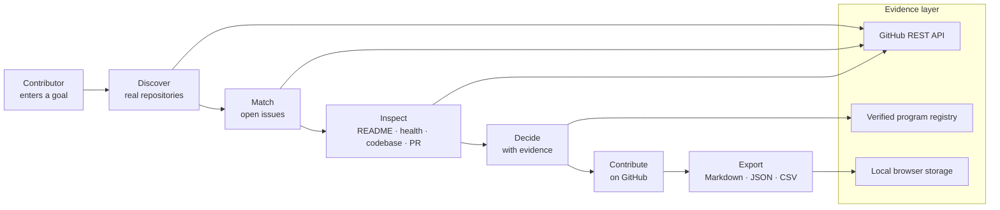
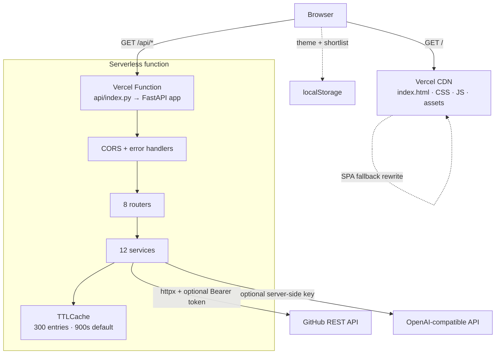
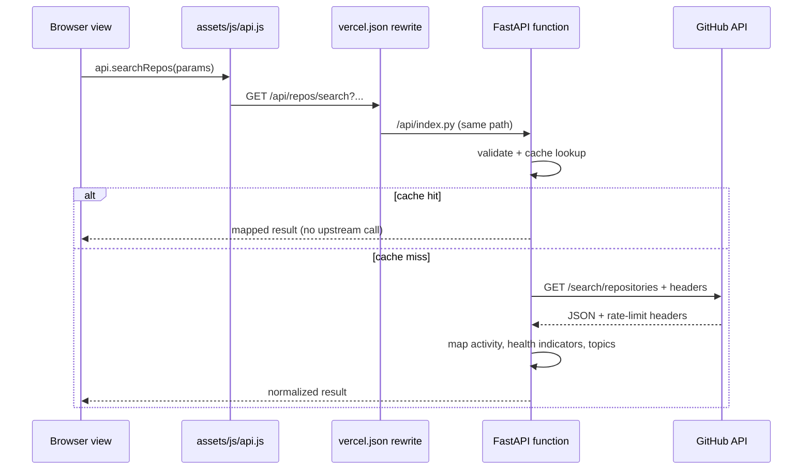
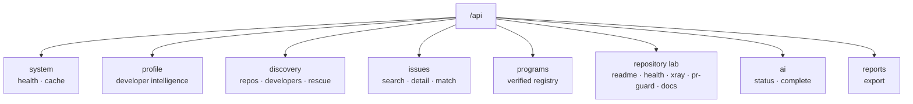

# DevAtlas — GitHub Profile Analyzer

**Contributor-first open-source intelligence.** Find real repositories, match genuinely open issues to public skill evidence, inspect repository health, and export defensible reports — without inventing data or executing untrusted code.

> **Runtime:** Python 3.12 · **API:** FastAPI 2.0 · **Frontend:** vanilla ES modules · **Hosting:** Vercel CDN + Python Functions · **Tests:** 19 passing

---

## The product in one picture



DevAtlas keeps the original Profile Analyzer intact as view **09**, then wraps it in a nine-view workspace backed by a FastAPI service. The service is a serverless-compatible ASGI application: the same `app` object runs under Uvicorn locally and on Vercel.

---

## What is real, and what is not

| Claim | Implementation reality |
| --- | --- |
| Profile, repository, issue and PR data | Fetched from the GitHub REST API; most GET responses use a bounded 15-minute TTL cache, searches use 3–5 minutes |
| Issue revalidation | `POST /api/issues/match` re-fetches each candidate with `cache=False`, then skips closed, assigned or invalid issues |
| Program dates | Static registry verified on `2026-11-26`; unpublished values are `null`, never guessed |
| Scores | Deterministic heuristics from public metadata; not a measure of engineering ability |
| Repository tools | Read-only text analysis; no repository code is executed, no GitHub write endpoint exists |
| AI helpers | Optional backend proxy requiring `OPENAI_API_KEY`; deterministic tools work without it |
| Collaboration entries | Stored only in the current browser under `devatlas.collab.entries` |
| PDF export | Not generated; use the browser print dialog |

---

## Deployment topology



On Vercel, static files are served from the CDN and API traffic is rewritten to a single Python function. Local development uses one Uvicorn process that serves both.

---

## Quick start

### Local

```bash
python -m pip install -r requirements.txt
python -m pip install -r backend/requirements.txt
uvicorn app.main:app --app-dir backend --reload
```

Open <http://127.0.0.1:8000>. Interactive API documentation is at <http://127.0.0.1:8000/api/docs>.

### Vercel

1. Import the repository into Vercel. The detected framework is intentionally **Other** (`framework: null`).
2. Keep the build defaults — there is no build command to configure.
3. Add optional secrets in **Project Settings → Environment Variables**. Never place them in `assets/` or `index.html`.
4. Deploy, then verify `/api/health`, `/`, `/assets/js/app.js` and `/api/docs`.

Detailed runbook: [`docs/operations/DEPLOYMENT.md`](docs/operations/DEPLOYMENT.md).

### Environment variables

| Variable | Default | Secret? | Purpose |
| --- | --- | --- | --- |
| `GITHUB_TOKEN` | unset | Yes | Raises GitHub limit from 60 to 5,000 requests/hour |
| `OPENAI_API_KEY` | unset | Yes | Enables AI Lab; without it the API returns `503 ai_not_configured` |
| `OPENAI_MODEL` | `gpt-4o-mini` | No | Model sent to the provider |
| `OPENAI_BASE_URL` | `https://api.openai.com/v1` | No | OpenAI-compatible endpoint |
| `GITHUB_API_BASE` | `https://api.github.com` | No | GitHub API base; keep on GitHub hosts |
| `GITHUB_TIMEOUT` | `15` | No | Upstream HTTP timeout in seconds |
| `CACHE_TTL_SECONDS` | `900` | No | Default TTL for cached GET responses |
| `CACHE_MAX_ENTRIES` | `300` | No | Cache capacity; `0` disables writes |
| `CORS_ORIGINS` | localhost + `VERCEL_URL` | No | Browser origins allowed by CORS |
| `APP_ROOT` | resolved repository root | No | Static file root; `api/index.py` sets it automatically on Vercel |

---

## Workspace views

| # | View | What it does | Primary API |
| --- | --- | --- | --- |
| 01 | Overview | Live service state, program count, workflow entry points | `/api/health`, `/api/programs` |
| 02 | Explore | Repository search with language, category, stars, sort and pagination | `/api/repos/search` |
| 03 | Contributions | Skills from public repos matched against revalidated open issues | `/api/issues/match` |
| 04 | Programs | Filters over the verified program registry | `/api/programs` |
| 05 | Developer DNA | Five transparent scores, skill evidence and growth timeline | `/api/profile/{username}` |
| 06 | Repository Lab | README Doctor, Health, X-Ray, PR Guardian, Docs Drafts | `/api/repository/*` |
| 07 | AI Lab | Optional, clearly labelled AI guidance | `/api/ai/status`, `/api/ai/complete` |
| 08 | Collab Hub | Browser-only shortlist; no seeded or synced entries | none |
| 09 | Profile Analyzer | Preserved legacy analyzer, charts and contribution heatmap | public GitHub API |

API-only capabilities not exposed as sidebar views: `/api/repos/rescue`, `/api/repos/{owner}/{repo}`, `/api/developers/search`, `/api/issues/search`, `/api/issues/{owner}/{repo}/{number}`, and cache inspection.

---

## Request lifecycle



---

## Caching and freshness

| Operation | TTL | Notes |
| --- | --- | --- |
| Profile, repository, language, tree, contents, README | 900s default | Key includes path and normalized query parameters |
| Repository and user search | 300s | Filter combinations are cached independently |
| Issue search | 180s | Short window for fast-changing triage lists |
| Issue detail during matching | `cache=False` | Explicit request-time revalidation |
| Programs, reports, AI completions | not cached | Deterministic registry or caller-provided payload |

The cache is process-local. On Vercel each warm function instance has its own cache; a cold start begins empty. `GET /api/cache` exposes statistics and `DELETE /api/cache` clears the current instance.

---

## API surface



Full reference: [`docs/product/API_REFERENCE.md`](docs/product/API_REFERENCE.md). OpenAPI: `/api/docs`, `/api/redoc`, `/api/openapi.json`.

---

## Repository map

```text
GitHub-Profile-Analyzer/
├── api/index.py                  Vercel ASGI adapter
├── vercel.json                   rewrites, headers, function config
├── requirements.txt              runtime dependencies (Vercel)
├── .python-version               Python 3.12 pin
├── index.html                    SPA shell + preserved analyzer markup
├── style.css / script.js         preserved legacy analyzer
├── assets/
│   ├── css/app.css               workspace design system
│   └── js/                       api.js, ui.js, app.js, views/*.js
├── backend/
│   ├── app/core/                 config, cache, validation, errors
│   ├── app/services/             GitHub client + 10 analysis services
│   ├── app/routers/              8 route groups
│   └── tests/                    19 automated tests
└── docs/                         product, architecture, security, operations, testing, research
```

---

## Documentation

| Area | Documents |
| --- | --- |
| Product | [User Guide](docs/product/USER_GUIDE.md) · [API Reference](docs/product/API_REFERENCE.md) · [Feature Status](docs/product/FEATURE_STATUS.md) · [Implementation Plan](docs/product/IMPLEMENTATION_PLAN.md) · [Project Audit](docs/product/PROJECT_AUDIT.md) |
| Architecture | [System Overview](docs/architecture/SYSTEM_OVERVIEW.md) · [Frontend Architecture](docs/architecture/FRONTEND_ARCHITECTURE.md) · [Database Schema](docs/architecture/DATABASE_SCHEMA.md) |
| Operations | [Deployment](docs/operations/DEPLOYMENT.md) · [Security](docs/security/SECURITY.md) · [Test Plan](docs/testing/TEST_PLAN.md) |
| Research | [Program Sources](docs/research/PROGRAM_SOURCES.md) |

---

## Verification

```bash
cd backend && python -m pytest -q
python -m json.tool vercel.json >/dev/null
python -c "import api.index; print(api.index.app.title)"
node --check --input-type=module < assets/js/app.js
```

The last verification in this workspace: **19 tests passed**, adapter import succeeded, `vercel.json` parsed successfully. The deployment runbook has not been executed against a live Vercel project.

---

## Known limits

- No database; state is either process-local cache or browser `localStorage`.
- Private contributions, non-GitHub work and skills without public evidence are not represented.
- Repository analysis samples bounded file sets; it is not a full static-analysis platform.
- PDF export is intentionally replaced by browser print.
- GitHub write actions, OAuth, queues and notifications are documented but not enabled.

## Checkpoints

| Commit | Milestone |
| --- | --- |
| `68cc42a` | Audit and preservation checklist |
| `20e40a3` | Architecture and implementation plan |
| `545a40a` | Backend services and tests |
| `e3e6004` | Ignore bytecode and local env files |
| `74f245c` | Workspace UI, documentation and deployment adapter |
| `fd6948f` | Workspace checkpoint |
| `b56565e` | Headless browser verification record |
