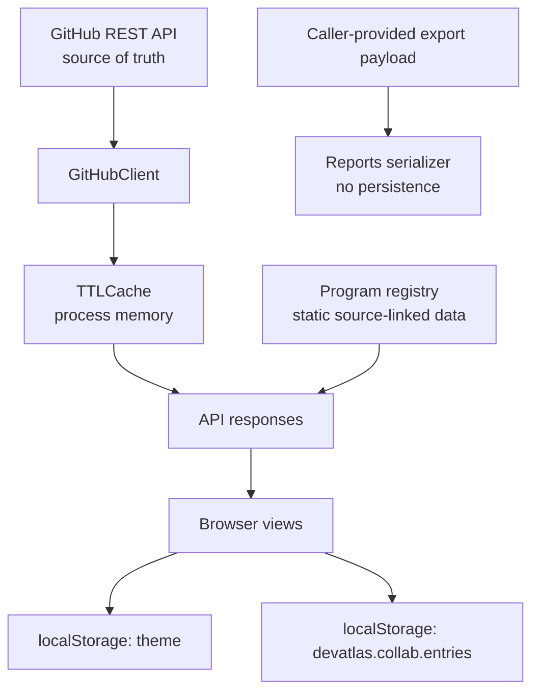
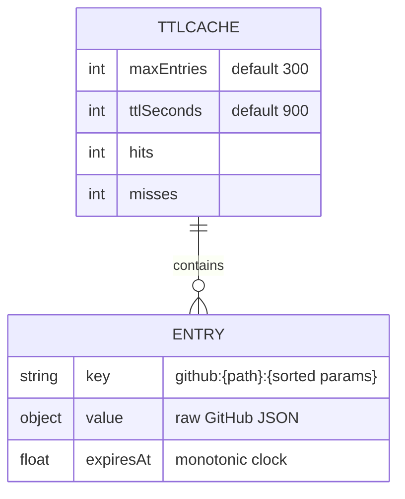
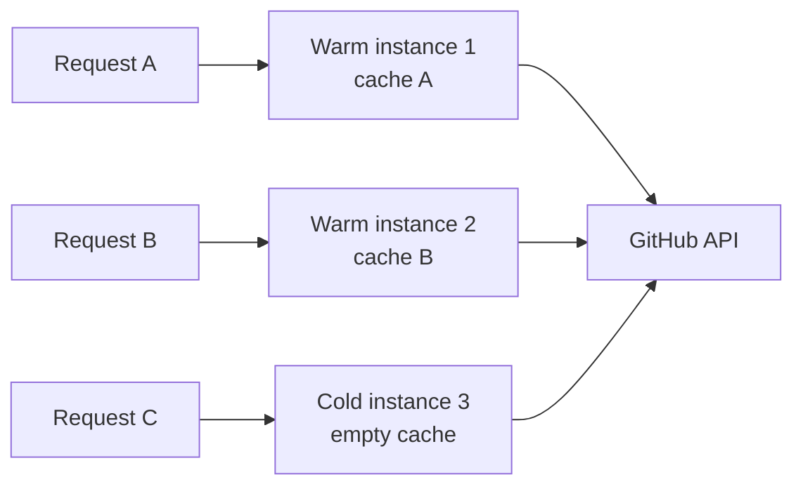
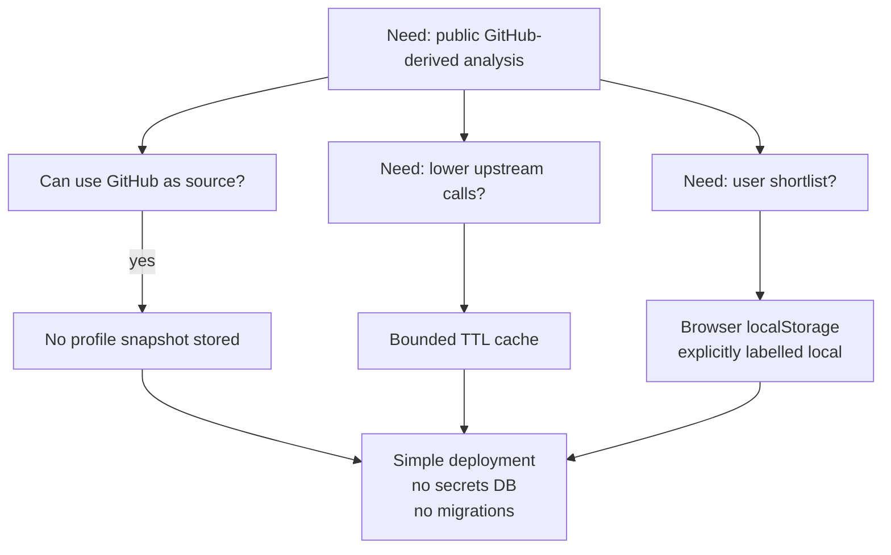

# Database Schema

**Current release:** no database. This is an intentional deployment and privacy decision, not a missing migration.

---

## 1. Current persistence model



| Store | Lifetime | Scope | Contents |
| --- | --- | --- | --- |
| `TTLCache` | Process lifetime, TTL-limited | One serverless instance | GitHub GET responses keyed by path + normalized params |
| `localStorage: theme` | Until user clears it | One browser profile | `light` or `dark` |
| `localStorage: devatlas.collab.entries` | Until user removes it | One browser profile | Up to 100 URL/title notes |
| Program registry | Deployment lifetime | Application code | Eight source-linked records |
| Report payload | Request lifetime | Caller | JSON/CSV/Markdown serialization only |

There are no user accounts, no server-side saved items, and no persisted GitHub profile data.

---

## 2. In-memory cache shape



```json
{
  "cache": {
    "entries": 42,
    "maxEntries": 300,
    "hits": 118,
    "misses": 55,
    "ttlSeconds": 900
  }
}
```

Behavior:

- Lazy expiry on `get()` removes stale entries and records a miss.
- `set()` accepts a per-call TTL override: 300s for searches, 180s for issue search.
- When capacity is reached, stale entries are removed first, then insertion-order entries are popped.
- `clear()` removes entries but preserves hit/miss counters.
- `CACHE_MAX_ENTRIES=0` disables writes while reads still report misses.

### Deployment implication



On Vercel, the cache is **not shared** between function instances. Each instance warms independently; a cold start begins with an empty cache. Hit rates improve with traffic locality but are not a correctness dependency.

---

## 3. Browser storage shape

```mermaid
erDiagram
    COLLAB_STORE ||--o{ COLLAB_ENTRY : contains
    COLLAB_STORE {
        string key "devatlas.collab.entries"
        int maxEntries 100
    }
    COLLAB_ENTRY {
        string id
        string title
        string url
        string note
        string createdAt
    }
```

- Entries are created only through the Collab Hub form.
- URLs are validated to `http:` or `https:` before storage.
- Remove deletes a single entry; there is no server sync, sharing or seeding.
- Theme uses the pre-existing key `theme` from the preserved analyzer.

---

## 4. Future relational schema — planned, not implemented

If authenticated persistence is added later, the following normalized model is the intended baseline. No migration, ORM model, connection string or table exists today.

```mermaid
erDiagram
    USERS ||--o{ SAVED_ITEMS : saves
    USERS ||--o| OAUTH_ACCOUNTS : links
    USERS ||--o{ AUDIT_EVENTS : generates

    USERS {
        uuid id PK
        text github_login UK
        timestamptz created_at
        timestamptz updated_at
    }
    SAVED_ITEMS {
        uuid id PK
        uuid user_id FK
        text kind "repository|issue|program"
        text external_url
        text title
        text_array tags
        timestamptz created_at
    }
    ANALYSIS_CACHE {
        text cache_key PK
        jsonb payload
        timestamptz expires_at
    }
    OAUTH_ACCOUNTS {
        uuid user_id PK_FK
        text provider "default github"
        bytea encrypted_access_token
        text scope
        timestamptz expires_at
    }
    AUDIT_EVENTS {
        bigserial id PK
        uuid user_id FK
        text action
        text target
        timestamptz created_at
    }
```

### DDL reference

```sql
create table users (
  id uuid primary key,
  github_login text unique not null,
  created_at timestamptz not null default now(),
  updated_at timestamptz not null default now()
);

create table saved_items (
  id uuid primary key,
  user_id uuid not null references users(id) on delete cascade,
  kind text not null check (kind in ('repository', 'issue', 'program')),
  external_url text not null,
  title text not null,
  tags text[] not null default '{}',
  created_at timestamptz not null default now()
);

create table analysis_cache (
  cache_key text primary key,
  payload jsonb not null,
  expires_at timestamptz not null
);

create table oauth_accounts (
  user_id uuid primary key references users(id) on delete cascade,
  provider text not null default 'github',
  encrypted_access_token bytea not null,
  scope text not null,
  expires_at timestamptz
);

create table audit_events (
  id bigserial primary key,
  user_id uuid references users(id) on delete set null,
  action text not null,
  target text not null,
  created_at timestamptz not null default now()
);
```

---

## 5. Rules for a future implementation

| Area | Requirement |
| --- | --- |
| Tokens | Encrypted at rest, least-privilege scopes, never returned to the browser |
| Cache rows | Expire by `expires_at` and support explicit deletion |
| Audit events | Record action and target only; never store token values or raw secrets |
| Migrations | Versioned, reversible, and reviewed before enabling writes |
| Tenant isolation | Every user-scoped query filters by `user_id` |
| Retention | Saved items and audit events need an explicit retention policy before launch |
| Vercel fit | Use an external managed database; serverless filesystems and in-memory state are ephemeral |

---

## 6. Why no database now



This keeps the first release stateless enough for serverless deployment and avoids storing personal data that the product does not need.
