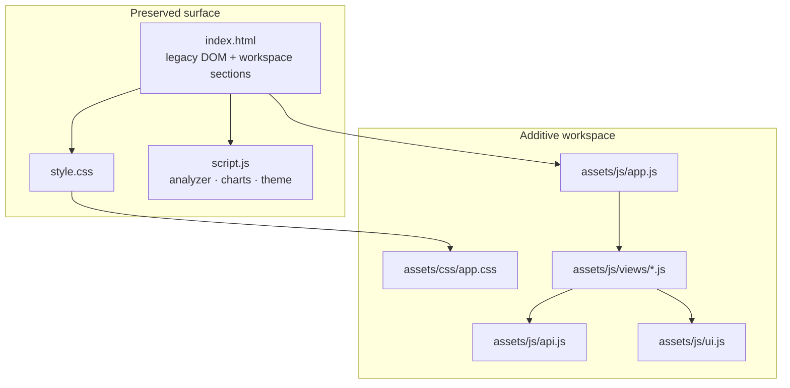
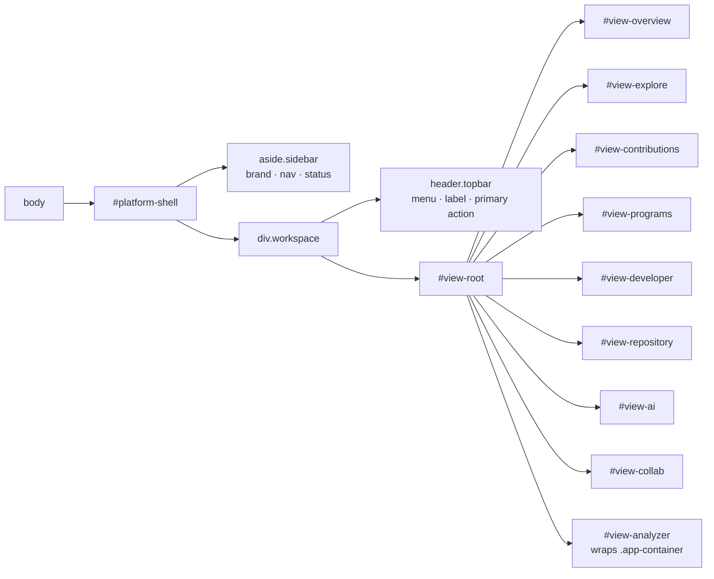
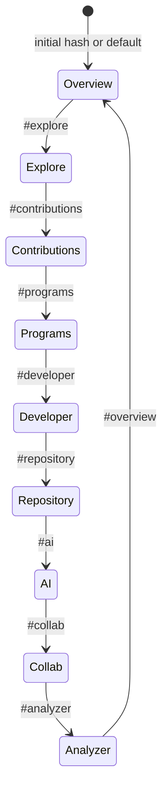
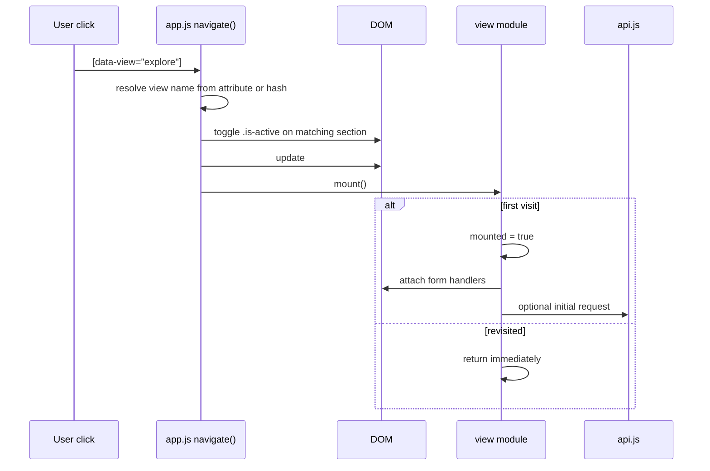
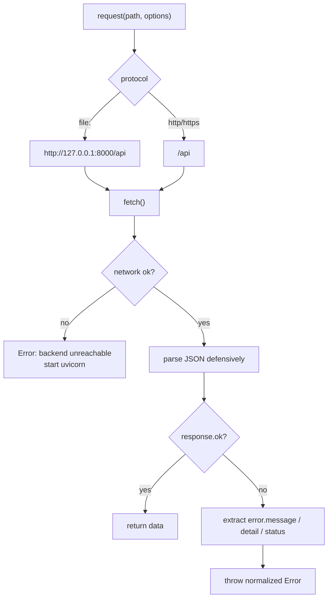
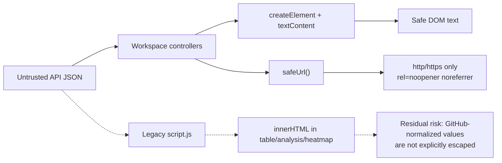
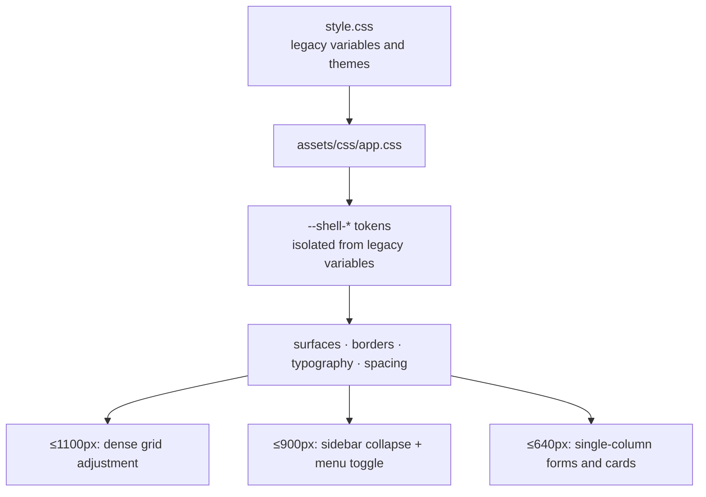
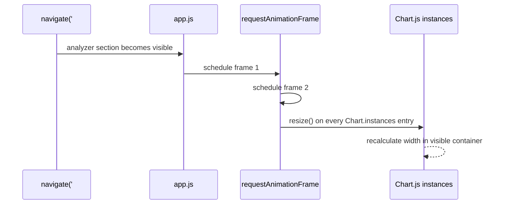

# Frontend Architecture

**Scope:** the browser shell in `index.html`, the preserved legacy analyzer in `script.js`, and the additive workspace modules in `assets/`.

---

## 1. Design contract



Rules:

1. The legacy analyzer is preserved, not rewritten. Its markup, IDs, stylesheet and script remain functional.
2. Workspace CSS loads **after** `style.css`; workspace JS loads as an ES module after the legacy script.
3. New views use `document.createElement` and `textContent` for API values. Legacy code remains intentionally unchanged in behavior.
4. Each controller mounts once, guarded by a `mounted` flag, even though navigation calls `mount()` on every visit.
5. Same-origin `/api` is the only backend channel; `file://` falls back to `http://127.0.0.1:8000/api`.

---

## 2. Shell anatomy



| Shell element | Responsibility |
| --- | --- |
| `.sidebar` | Nine numbered navigation buttons and live backend status |
| `.topbar` | Current view label, narrow-screen menu toggle, analyzer shortcut |
| `#view-root` | Contains one active `.view` section at a time |
| `#view-analyzer` | Wraps the untouched legacy analyzer container |
| `data-view` / `data-view-link` | Declarative navigation triggers read by `app.js` |

---

## 3. Routing and mount lifecycle





### View controller map

| View key | Module | Initial data | User-triggered data |
| --- | --- | --- | --- |
| `overview` | `views/overview.js` | `/api/health`, `/api/programs` | none |
| `explore` | `views/explore.js` | none | `/api/repos/search` |
| `contributions` | `views/contributions.js` | none | `/api/issues/match` |
| `programs` | `views/programs.js` | `/api/programs` | refresh + debounced filters |
| `developer` | `views/developer.js` | none | `/api/profile/{username}` |
| `repository` | `views/repository.js` | none | five `/api/repository/*` tools |
| `ai` | `views/ai.js` | `/api/ai/status` | `/api/ai/complete` |
| `collab` | `views/collab.js` | `localStorage` | no API |
| `analyzer` | none | Legacy `script.js` | public GitHub REST |

---

## 4. API client



Exposed methods:

```text
api.health()          api.programs(params)     api.profile(username)
api.searchRepos(p)    api.matchIssues(body)    api.aiStatus()
api.aiComplete(body)  api.repository(tool,b)   api.export(body)
```

`downloadReport()` posts to `/reports/export`, creates a Blob URL, clicks a temporary anchor, then revokes the URL after one second.

---

## 5. Rendering boundary



| Area | Encoding approach | Notes |
| --- | --- | --- |
| New workspace views | DOM APIs + `textContent` | Values are never concatenated into `innerHTML` |
| Links | `safeUrl()` allowlist | Only `http:` and `https:`; adds `rel="noopener noreferrer"` |
| Export buttons | Dynamic import of `downloadReport()` | Keeps report code out of initial shell |
| Legacy analyzer | `innerHTML` in selected render paths | Preserved for compatibility; documented residual risk in [`../security/SECURITY.md`](../security/SECURITY.md) |

---

## 6. Styling system



- The workspace design system is restrained and information-dense: neutral surfaces, hairline borders, monospace metadata and minimal gradients.
- Separate `--shell-*` custom properties prevent accidental overrides of legacy analyzer tokens.
- `app.css` is loaded after `style.css`, so workspace rules can refine shared elements without editing the preserved stylesheet.

---

## 7. Legacy ID contract

The following IDs must remain in `index.html` because `script.js` queries them directly:

| Group | IDs |
| --- | --- |
| Theme | `theme-toggle`, `theme-icon-light`, `theme-icon-dark` |
| Search | `search-form`, `github-input`, `analyze-btn` |
| States | `error-message`, `loading`, `empty-state` |
| Dashboard | `dashboard`, `avatar`, `name`, `username`, `bio`, `followers`, `following`, `public-repos`, `joined-date`, `location-line`, `location-val`, `company-line`, `company-val` |
| Statistics | `total-repos-stat`, `total-stars-stat`, `total-forks-stat`, `original-repos-stat`, `forked-by-you-stat`, `most-starred-stat`, `recent-repo-stat` |
| Score | `score-value`, `score-label`, `gauge-fill`, all `s-*` rows |
| Insights | all `ins-*` rows |
| Tables/charts | `repo-table-body`, `analysis-grid`, `languageChart`, `repoChart` |
| Heatmap | `streak-img-wrap`, `streak-meta`, `streak-card` |

Changing or renaming any of these would break the preserved analyzer until `script.js` is updated in lockstep.

---

## 8. Hidden chart handling



Charts created while the analyzer view is hidden can measure zero width. Two animation frames give the browser a layout pass before `resize()` runs.

---

## 9. Browser-only state

| Key | Owner | Shape | Behavior |
| --- | --- | --- | --- |
| `theme` | `script.js` | `light` / `dark` | Legacy analyzer preference, persists across reloads |
| `devatlas.collab.entries` | `views/collab.js` | JSON array | Up to 100 entries; validated URLs; no sync or seeding |

No API token, GitHub data snapshot or AI key is stored in browser state.

---

## 10. Vercel considerations

- `assets/js/app.js` and all view modules are served as static files from the CDN; they are not bundled by a framework build.
- `api.js` uses relative `/api`, so preview deployments, production domains and local Uvicorn all work without a hardcoded host.
- The SPA fallback rewrite sends unknown paths to `index.html`; static files still take precedence.
- No frontend module imports backend Python or reads environment variables.

For the complete routing and environment runbook, see [`../operations/DEPLOYMENT.md`](../operations/DEPLOYMENT.md).
