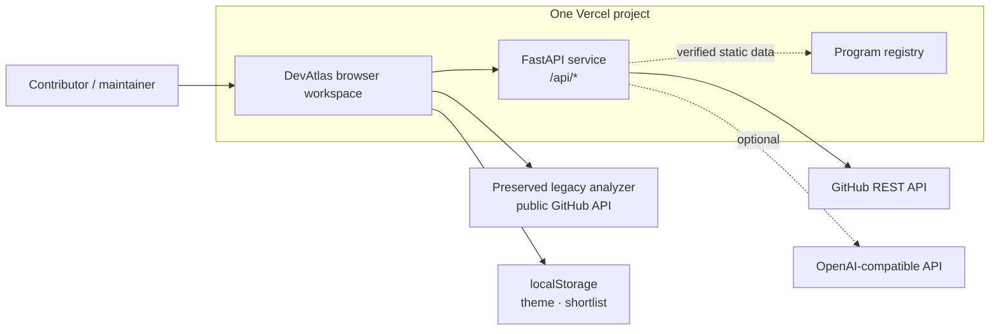
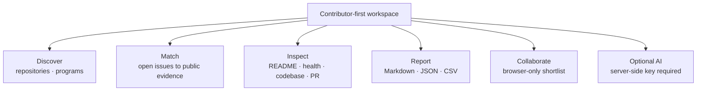
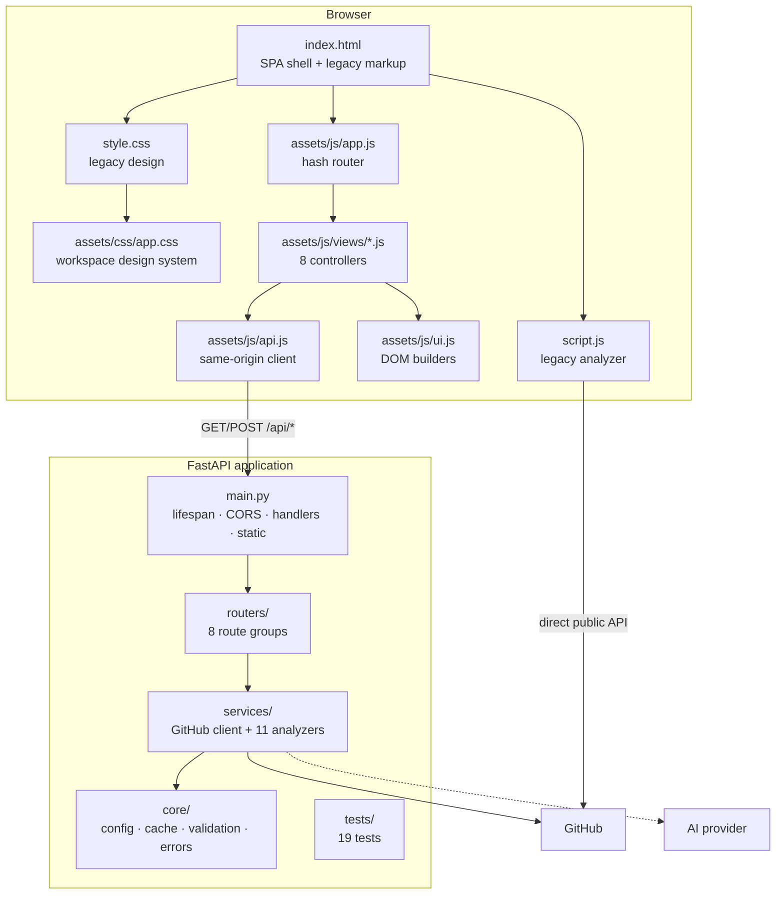
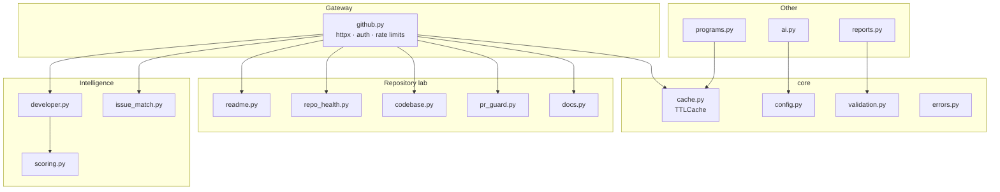
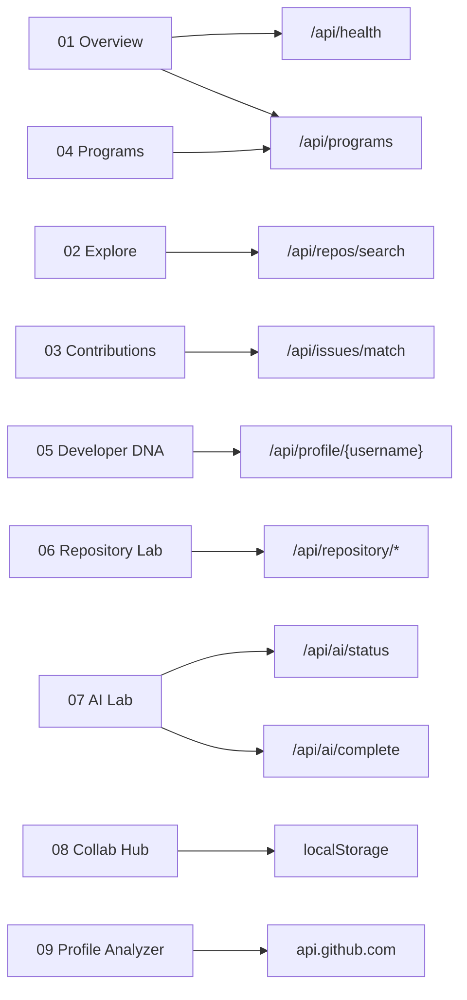
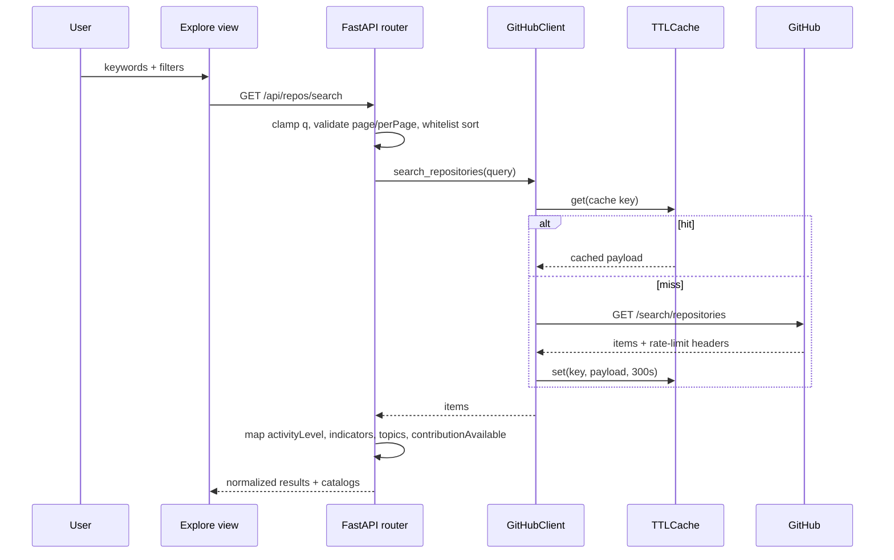
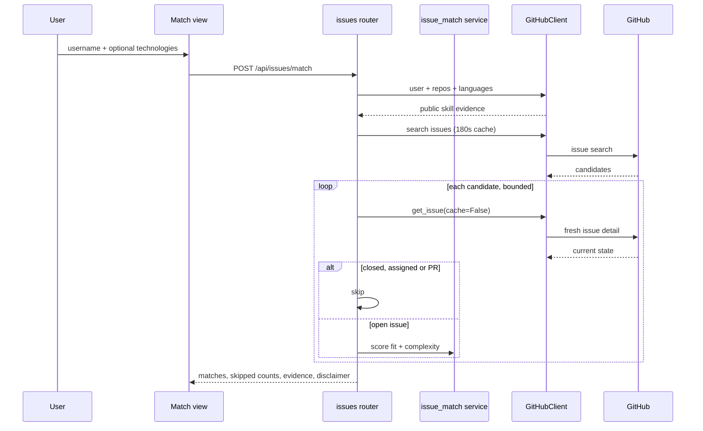
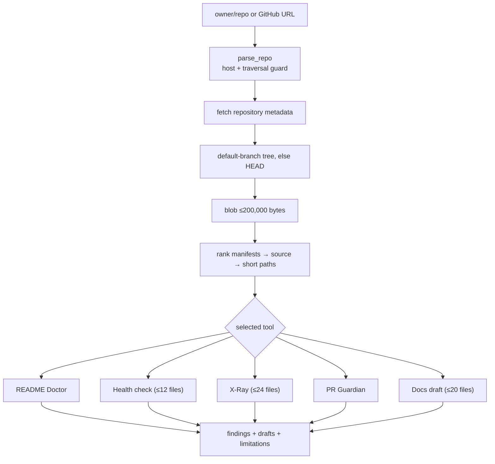
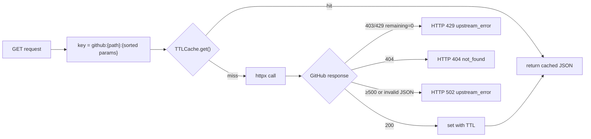
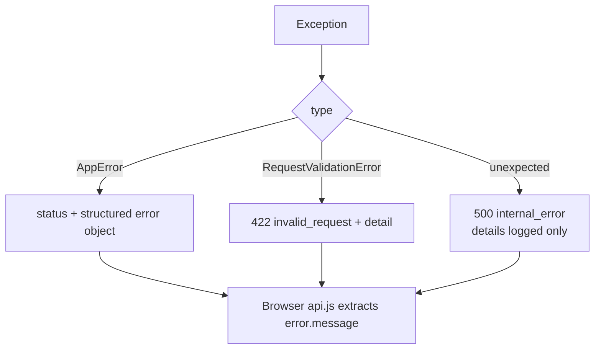

# System Overview

**Version:** 2.0 · **Scope:** implemented system, not a target wishlist · **Last verified:** 2026-11-27

DevAtlas is a single-origin application: a static browser workspace, one FastAPI service, and bounded integrations with GitHub and an optional AI provider. It deliberately has no database and no write path.

---

## 1. System context



### Product hierarchy



The original analyzer remains view **09**, with its scoring formula, charts, heatmap and theme persistence unchanged in behavior.

---

## 2. Container architecture



| Layer | Modules | Responsibility |
| --- | --- | --- |
| Shell | `index.html`, `style.css`, `assets/css/app.css` | Navigation, view sections, visual system, legacy markup preservation |
| Browser logic | `assets/js/app.js`, `api.js`, `ui.js`, `views/*.js` | Routing, mounting, API access, rendering with DOM APIs |
| Legacy logic | `script.js` | Preserved analyzer, charts, heatmap, theme |
| HTTP | `backend/app/main.py` | ASGI app, middleware, exception handlers, static routes |
| Core | `backend/app/core/` | Settings, TTL cache, validators, structured errors |
| Routers | `backend/app/routers/` | Request parsing, orchestration, response shaping |
| Services | `backend/app/services/` | GitHub gateway and deterministic analysis engines |

---

## 3. Backend component map



### Service responsibilities

| Service | Input | Output | Deterministic? |
| --- | --- | --- | --- |
| `github.py` | Path + params | Raw GitHub JSON, mapped errors | Yes |
| `developer.py` | Username | Profile, stats, languages, scores, timeline, up to 30 summarized repos | Yes |
| `scoring.py` | Public metadata | Legacy 100-point score + five transparent score blocks | Yes |
| `issue_match.py` | Skill map + issues | Fit score, difficulty, evidence, starting guide | Yes |
| `readme.py` | README text + metadata | Findings, score, before/after Markdown | Yes |
| `repo_health.py` | Bounded file set | Docs, legal, security, quality, activity findings | Yes |
| `codebase.py` | Bounded source files | Extensions, entrypoints, routes, local imports, evidence lines | Yes |
| `pr_guard.py` | PR diff metadata | Confirmed findings separated from hypotheses | Yes |
| `docs.py` | Repository context | Four documentation drafts | Yes |
| `programs.py` | Static registry + filters | Eight verified program records | Yes |
| `ai.py` | Prompt + context | Provider text, usage, disclaimer | No — optional |
| `reports.py` | Caller payload | JSON, flattened CSV or Markdown | Yes |

---

## 4. API contract

All functional routes are under `/api`. Interactive documentation is intentionally under the same prefix so it cannot collide with the repository's physical `docs/` directory.

| Group | Endpoints | Count |
| --- | --- | --- |
| System | `GET /api/health`, `GET /api/cache`, `DELETE /api/cache` | 3 |
| Profile | `GET /api/profile/{username}` | 1 |
| Discovery | `GET /api/repos/search`, `GET /api/repos/rescue`, `GET /api/repos/{owner}/{repo}`, `GET /api/developers/search` | 4 |
| Issues | `GET /api/issues/search`, `GET /api/issues/{owner}/{repo}/{number}`, `POST /api/issues/match` | 3 |
| Programs | `GET /api/programs` | 1 |
| Repository Lab | `POST /api/repository/{readme,health,xray,pr-guard,docs-generate}` | 5 |
| AI | `GET /api/ai/status`, `POST /api/ai/complete` | 2 |
| Reports | `POST /api/reports/export` | 1 |
| Docs/static | `/api/docs`, `/api/redoc`, `/api/openapi.json`, `/`, `/style.css`, `/script.js`, `/assets/*`, `/docs-static/*` | platform |

Full parameter and response details: [`../product/API_REFERENCE.md`](../product/API_REFERENCE.md).

---

## 5. View-to-API map



| View | Mount behavior | Data source |
| --- | --- | --- |
| Overview | Mounted once | Health + program count |
| Explore | Form submit | Repository search with `perPage=12` |
| Contributions | Form submit | Issue match with default limit 8 |
| Programs | Mount, refresh, debounced filters | Program registry |
| Developer DNA | Form submit | Developer intelligence |
| Repository Lab | Form submit / tool buttons | Five repository endpoints |
| AI Lab | Mount + submit | AI status and completion |
| Collab Hub | Form submit / remove | Browser storage only |
| Profile Analyzer | Legacy script | Public GitHub API and third-party heatmap images |

API-only endpoints have no sidebar view: cache inspection, repository rescue, direct repository detail, developer search, issue search and issue detail.

---

## 6. Core data flows

### Discovery



### Contribution matching



### Repository Lab



---

## 7. Caching and rate limits



| Operation class | TTL |
| --- | --- |
| Profile, repository, language, tree, contents, README, PR | 900s default |
| Repository search, user search | 300s |
| Issue search | 180s |
| Issue detail used for revalidation | no cache |
| Rate-limit endpoint | no cache |

Cache properties:

- Bounded by `CACHE_MAX_ENTRIES` (default 300).
- Thread-safe with lazy expiry and monotonic time.
- Evicts stale entries first, then insertion-order entries.
- Process-local: Vercel instances do not share cache state.
- `GET /api/cache` reports `entries`, `maxEntries`, `hits`, `misses`, `ttlSeconds`.

---

## 8. Error model



Standard shape:

```json
{
  "error": {
    "code": "upstream_error",
    "message": "GitHub rate limit exhausted.",
    "detail": { "rateLimitRemaining": 0, "rateLimitReset": "..." }
  }
}
```

Two endpoints intentionally return an in-body `error` object with HTTP 200: invalid program status, and a PR number passed to the issue-detail route. Clients must check both `response.ok` and `data.error`.

---

## 9. Design principles

1. **No fabricated data.** Live data is fetched; registry data is source-linked; missing values stay `null`.
2. **Deterministic first.** Every core tool works without AI. AI is an optional enhancement, never a fact source.
3. **Secrets stay server-side.** Only boolean integration status reaches the browser.
4. **Repository content is data.** No execution, no shell calls, bounded file count and size.
5. **Graceful degradation.** The legacy analyzer still works against public GitHub if the backend is unavailable; workspace views show setup guidance instead of fake content.
6. **Honest labels.** Scores are heuristics, activity is inferred from push dates, and "rescue" results never claim a project is abandoned.

---

## 10. Non-goals for this release

| Non-goal | Current substitute |
| --- | --- |
| Persistent accounts and database | GitHub source of truth + process-local cache |
| OAuth and GitHub writes | Read-only endpoints; `writeAction.enabled: false` |
| Redis / shared cache | Bounded in-memory TTLCache |
| Background jobs | Synchronous bounded analysis |
| Real-time notifications | Not implemented |
| PDF generation | Browser print dialog |
| Full static-analysis engine | Representative file sampling with explicit limits |

Deployment mechanics are documented in [`../operations/DEPLOYMENT.md`](../operations/DEPLOYMENT.md); browser internals in [`frontend-architecture.md`](frontend-architecture.md).
