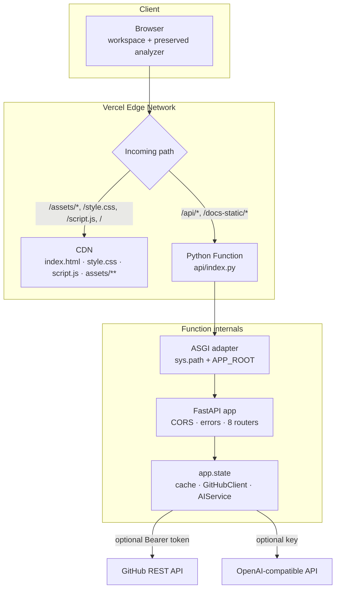
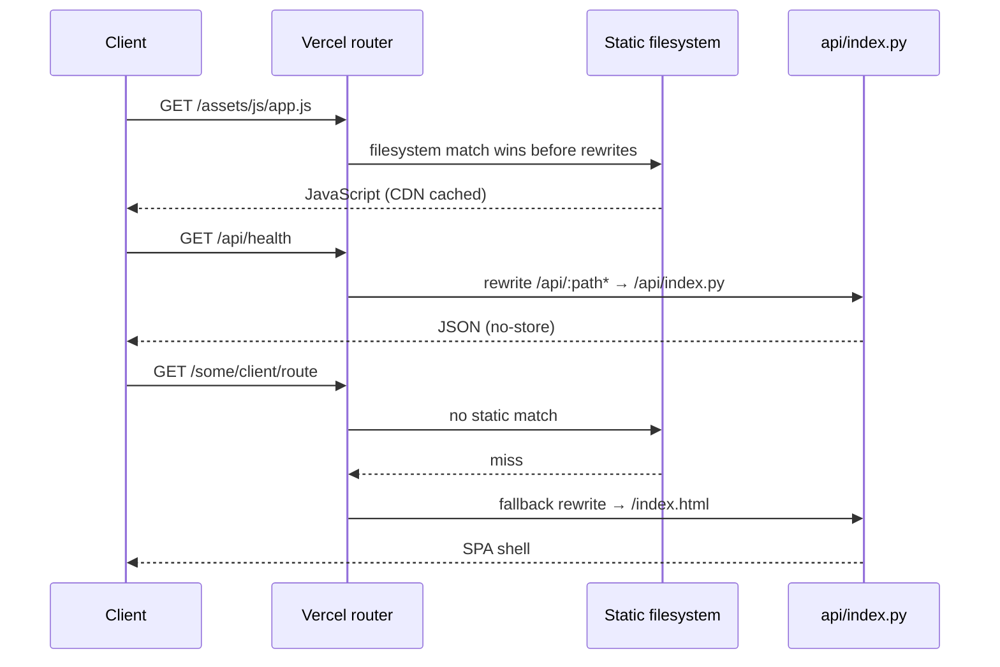
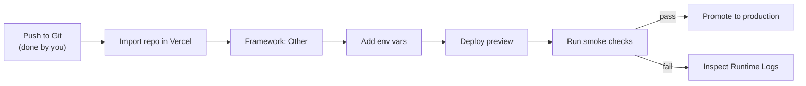
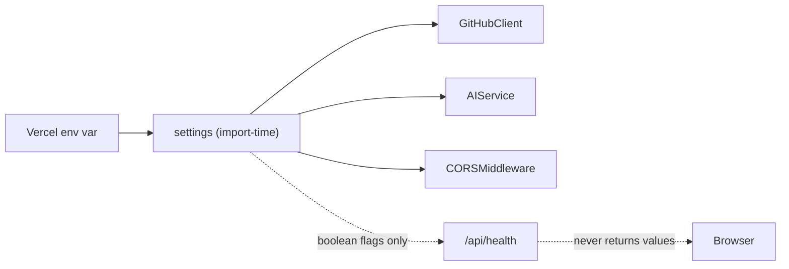
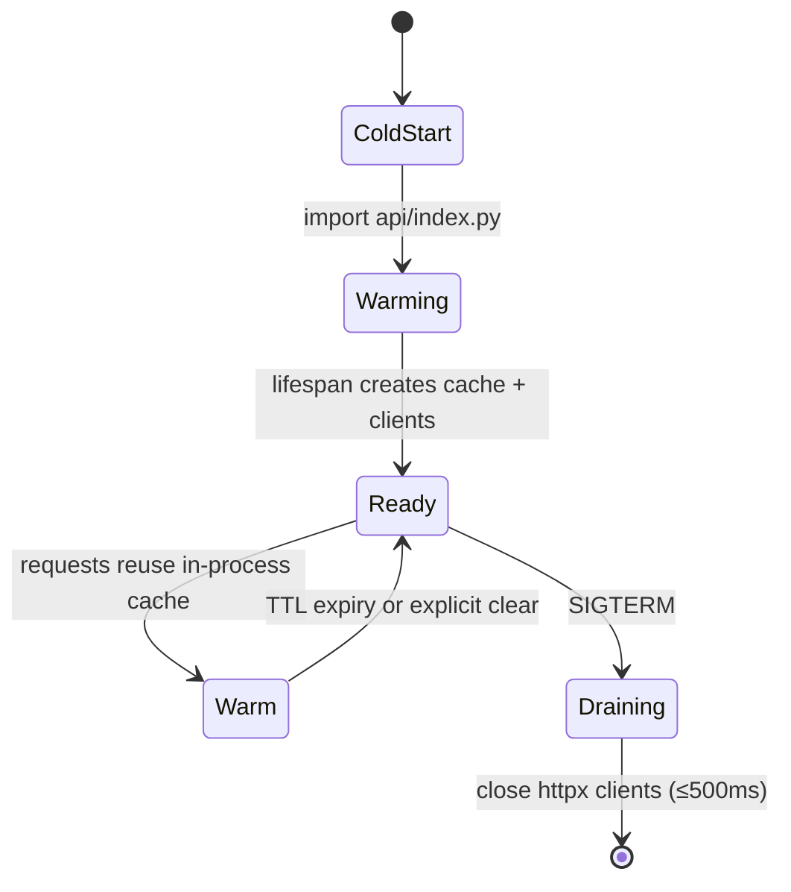

# Deployment

**Target:** one Vercel project serving a static browser workspace and one Python FastAPI function on the same domain.

> **Status:** configuration hardened for the current Vercel Python runtime. Local import, JSON parsing and 19 tests pass. A live Vercel deployment has not been executed from this workspace.

---

## 1. Deployment topology



Static files never invoke the function. API traffic is rewritten to `/api/index.py`, which exports the same FastAPI `app` object used by Uvicorn locally.

---

## 2. Files that make it work

| File | Role | Why it matters on Vercel |
| --- | --- | --- |
| `vercel.json` | Routing, caching, function config | Uses modern `rewrites`/`headers` instead of legacy `builds`/`routes`; sets `framework: null` so no frontend preset rewrites the app |
| `api/index.py` | ASGI entrypoint | Recognized entrypoint name; inserts `backend/` on `sys.path`, sets `APP_ROOT`, exports `app` |
| `requirements.txt` | Runtime dependencies | Root-level manifest is detected by Vercel's Python installer; excludes test-only packages |
| `.python-version` | `3.12` | Pins a supported Python runtime instead of relying on the platform default |
| `backend/requirements.txt` | Local/dev dependencies | Includes root runtime manifest plus Uvicorn and pytest |
| `backend/app/main.py` | FastAPI application | Declares `/api/docs`, `/api/redoc`, `/api/openapi.json` under the API prefix |

### Entry adapter

```python
import os
import sys
from pathlib import Path

ROOT = Path(__file__).resolve().parents[1]
sys.path.insert(0, str(ROOT / "backend"))
os.environ.setdefault("APP_ROOT", str(ROOT))

from app.main import app  # noqa: E402

__all__ = ["app"]
```

`APP_ROOT` is important because the app serves `index.html`, `style.css`, `script.js`, `/assets` and `/docs-static` relative to that root. The adapter resolves it from the function file, so it does not depend on the process working directory.

### Routing contract



| Rule | Destination | Reason |
| --- | --- | --- |
| `/api/:path*` | `/api/index.py` | All API routers, health checks and OpenAPI routes |
| `/docs-static/:path*` | `/api/index.py` | Preserves the FastAPI static mount for repository docs |
| `/(.*)` | `/index.html` | SPA fallback; static files still win because Vercel checks the filesystem first |
| `/api/docs` | function | API docs were moved under `/api` to avoid the repository's physical `docs/` directory |

Cache headers:

- `/assets/*`, `/style.css`, `/script.js`: `public, max-age=3600, stale-while-revalidate=86400`.
- `/index.html`: `public, max-age=0, must-revalidate`.
- `/api/*`: `no-store` — GitHub responses are already cached in-process with deliberate TTLs.

Function config:

- `maxDuration: 30` seconds. Every upstream call has a 15-second HTTP timeout and repository tools are file-bounded. Increase this in `vercel.json` only if a Pro workload needs longer AI completions.
- `includeFiles: backend/**/*.py` guarantees every imported backend module is bundled even though the entrypoint imports through a dynamic `sys.path`.

---

## 3. Deploy from Git



Steps:

1. Push your branch to the connected Git provider. No changes are pushed by this workspace.
2. In Vercel, choose **Add New → Project** and import the repository.
3. Leave **Framework Preset** as **Other**. Do not set a build command or install command.
4. Set **Root Directory** to the repository root.
5. Add the environment variables below for Production and Preview.
6. Deploy a preview first, run the smoke checks, then promote to production.

---

## 4. Environment variables

| Variable | Required | Secret | Production value guidance |
| --- | --- | --- | --- |
| `GITHUB_TOKEN` | No | Yes | Fine-grained or classic token with public read access; raises limit to 5,000/hour |
| `OPENAI_API_KEY` | No | Yes | Only if AI Lab should be enabled |
| `OPENAI_MODEL` | No | No | Default `gpt-4o-mini` |
| `OPENAI_BASE_URL` | No | No | Default `https://api.openai.com/v1`; must be OpenAI-compatible |
| `GITHUB_API_BASE` | No | No | Keep `https://api.github.com`; pointing this elsewhere would forward the Bearer token to another host |
| `GITHUB_TIMEOUT` | No | No | Default `15` seconds |
| `CACHE_TTL_SECONDS` | No | No | Default `900` seconds |
| `CACHE_MAX_ENTRIES` | No | No | Default `300`; `0` disables caching |
| `CORS_ORIGINS` | No | No | Leave unset to auto-allow localhost plus the deployment's `VERCEL_URL`; set explicitly for a custom domain if cross-origin clients are needed |
| `APP_ROOT` | No | No | The adapter sets it; override only for non-Vercel ASGI hosting |



Never prefix these variables with `NEXT_PUBLIC_`, inline them into `index.html`, or commit `.env`. The frontend can only observe enabled/disabled flags through `/api/health` and `/api/ai/status`.

---

## 5. Smoke checks

After deployment, replace `$URL` with the preview or production URL.

```bash
curl -sS "$URL/api/health"
curl -sS -o /dev/null -w '%{http_code} %{content_type}\n' "$URL/"
curl -sS -o /dev/null -w '%{http_code} %{content_type}\n' "$URL/assets/js/app.js"
curl -sS -o /dev/null -w '%{http_code} %{content_type}\n' "$URL/api/docs"
curl -sS -o /dev/null -w '%{http_code} %{content_type}\n' "$URL/style.css"
```

| Check | Expected result |
| --- | --- |
| `/api/health` | `{"status":"ok", ...}` with no token value |
| `/` | `200 text/html`, SPA shell containing `#platform-shell` |
| `/assets/js/app.js` | `200 application/javascript`, not HTML |
| `/assets/css/app.css` | `200 text/css` |
| `/api/docs` | `200 text/html`, Swagger UI |
| `/api/openapi.json` | `200 application/json` |
| `/api/health` headers | `cache-control: no-store` |
| `/assets/js/app.js` headers | `cache-control: public, max-age=3600, stale-while-revalidate=86400` |
| Browser sidebar | Shows **Online** when `/api/health` succeeds |
| Browser Program view | Renders eight registry entries |
| Browser analyzer view | Still loads charts and heatmap |
| Source search | `GITHUB_TOKEN` and `OPENAI_API_KEY` absent from all frontend files |

---

## 6. Runtime behavior on Vercel



- **Cold start:** empty cache, fresh `GitHubClient` and `AIService`.
- **Warm instance:** repeated GitHub GETs are served from the TTL cache until expiry.
- **Multiple instances:** caches are not shared. This is acceptable because all data is derived from public GitHub state.
- **Shutdown:** HTTP clients are closed in FastAPI lifespan cleanup. Vercel allows a short SIGTERM window, so no blocking shutdown work is performed.
- **Body limits:** Vercel Functions accept request bodies up to 4.5 MB by default; all API payloads are intentionally far smaller.

---

## 7. Local and container-style deployment

### Local Vercel parity

```bash
python -m venv .venv
python -m pip install -r requirements.txt
python -m pip install -r backend/requirements.txt
vercel dev
```

Use Vercel CLI `48.1.8` or newer. `vercel dev` exercises the same rewrite table and FastAPI app instance as production.

### Plain Uvicorn

```bash
python -m pip install -r backend/requirements.txt
uvicorn app.main:app --app-dir backend --reload
```

The backend serves the SPA and assets directly, so one process is sufficient.

### ASGI host

Run `app.main:app` with `--app-dir backend`, or import `api.index:app` from the repository root. Set `APP_ROOT` to the absolute repository root when the working directory differs. Terminate TLS at the platform edge and keep secrets in the host's secret store.

---

## 8. Troubleshooting

| Symptom | Likely cause | Fix |
| --- | --- | --- |
| `MODULE_NOT_FOUND: No module named app` | Runtime dependencies installed from the wrong manifest | Confirm root `requirements.txt` exists and `api/index.py` is the entrypoint |
| `500` on every `/api/*` request | Backend modules missing from function bundle | Keep `includeFiles: backend/**/*.py` in `vercel.json` |
| `/assets/js/app.js` returns HTML | SPA catch-all evaluated before static file | Verify filesystem-first rewrite order shown above; confirm `assets/` is committed |
| `/docs` returns the SPA instead of API docs | Expected: API docs live under `/api/docs` | Update bookmarks and external links |
| Sidebar says **Offline** | `/api/health` failed or CORS blocked the browser | Check Runtime Logs and `CORS_ORIGINS` |
| GitHub 429 | Unauthenticated limit exhausted | Set `GITHUB_TOKEN`; lower traffic; cache is per instance |
| AI Lab says not configured | No backend key | Set `OPENAI_API_KEY`; restart/redeploy so import-time settings refresh |
| Stale results | Warm instance cache | `DELETE /api/cache` or wait for TTL expiry |
| Cold-start latency | New function instance | Normal; keep dependency set minimal and avoid heavy imports |

---

## 9. Operational safety

- Secrets are set in Vercel only, never in frontend code or Git.
- API responses add `Cache-Control: no-store`; GitHub data freshness is controlled by the application TTL cache.
- CORS credentials are disabled. Same-origin dashboard traffic needs no extra origin configuration.
- Program dates are static and source-linked; the UI never invents deadlines.
- No GitHub write endpoint exists, so deployment cannot mutate repositories.
- Roll back with Vercel's instant rollback to a previous successful deployment; no database migration is involved.
