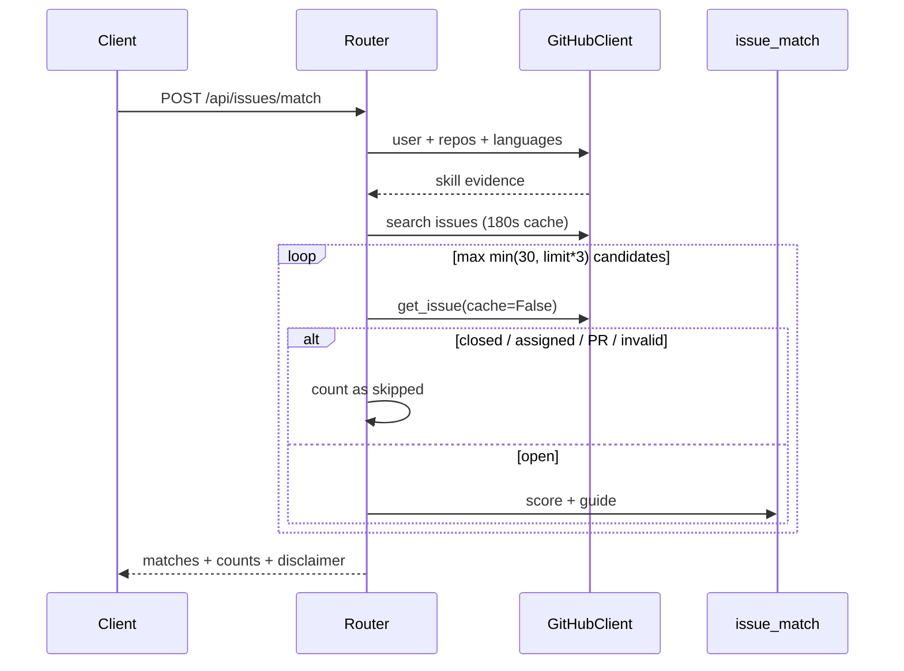

# API Reference

**Version:** 2.0.0 · **Base path:** `/api` · **Interactive docs:** `/api/docs` · **ReDoc:** `/api/redoc` · **Schema:** `/api/openapi.json`

Local base: `http://127.0.0.1:8000` · Vercel base: your deployment origin. All functional endpoints are same-origin and require no API key from the browser.

---

## 1. API map

```mermaid
graph TD
    API["/api"] --> SYS["System"]
    API --> PROF["Profile"]
    API --> DISC["Discovery"]
    API --> ISS["Issues"]
    API --> PROG["Programs"]
    API --> LAB["Repository Lab"]
    API --> AI["AI"]
    API --> REP["Reports"]

    SYS --> S1["GET /health"]
    SYS --> S2["GET /cache"]
    SYS --> S3["DELETE /cache"]
    PROF --> P1["GET /profile/{username}"]
    DISC --> D1["GET /repos/search"]
    DISC --> D2["GET /repos/rescue"]
    DISC --> D3["GET /repos/{owner}/{repo}"]
    DISC --> D4["GET /developers/search"]
    ISS --> I1["GET /issues/search"]
    ISS --> I2["GET /issues/{owner}/{repo}/{number}"]
    ISS --> I3["POST /issues/match"]
    PROG --> G1["GET /programs"]
    LAB --> L1["POST /repository/readme"]
    LAB --> L2["POST /repository/health"]
    LAB --> L3["POST /repository/xray"]
    LAB --> L4["POST /repository/pr-guard"]
    LAB --> L5["POST /repository/docs-generate"]
    AI --> A1["GET /ai/status"]
    AI --> A2["POST /ai/complete"]
    REP --> R1["POST /reports/export"]
```



---

## 2. Response and error contract

```json
{
  "error": {
    "code": "validation_error",
    "message": "Repository host must be github.com.",
    "detail": { "field": "repository" }
  }
}
```

| HTTP | Code | Source |
| --- | --- | --- |
| 400 | `validation_error` | Domain validation, unsafe URL, invalid issue number |
| 404 | `not_found` | GitHub resource missing |
| 422 | `invalid_request` | Pydantic request validation; `detail` contains field errors |
| 429 | `upstream_error` | GitHub or AI provider rate limit; includes reset detail |
| 500 | `internal_error` | Unexpected exception; details logged server-side only |
| 502 | `upstream_error`, `ai_*` | Transport failure, bad gateway, malformed provider response |
| 503 | `ai_not_configured` | No backend `OPENAI_API_KEY` |

Two routes return an in-body `error` object with HTTP 200:

| Route | Code | Meaning |
| --- | --- | --- |
| `GET /api/programs` | `invalid_status` | Unknown status filter |
| `GET /api/issues/{owner}/{repo}/{number}` | `not_an_issue` | GitHub number resolves to a pull request |

Clients must check both `response.ok` and `data.error`.

---

## 3. System

| Method | Path | Response |
| --- | --- | --- |
| `GET` | `/api/health` | Status, UTC timestamp, backend name, GitHub base/authentication flags, AI status, cache stats |
| `GET` | `/api/cache` | `{"cache": {"entries", "maxEntries", "hits", "misses", "ttlSeconds"}}` |
| `DELETE` | `/api/cache` | `{"clearedEntries": N}` |

```json
{
  "status": "ok",
  "timestamp": "2026-11-27T10:00:00+00:00",
  "backend": "fastapi",
  "integrations": {
    "github": {
      "apiBase": "https://api.github.com",
      "authenticated": true,
      "tokenExposedToFrontend": false
    },
    "ai": { "enabled": false }
  },
  "cache": { "entries": 12, "maxEntries": 300, "hits": 40, "misses": 12, "ttlSeconds": 900 }
}
```

---

## 4. Profile

| Method | Path | Notes |
| --- | --- | --- |
| `GET` | `/api/profile/{username}` | Accepts a username or GitHub profile URL segment |

Response groups:

| Field | Contents |
| --- | --- |
| `profile` | Public GitHub user object subset |
| `statistics` | Repo, star, fork, original and fork counts |
| `languages` | Byte-weighted language distribution from top non-fork repos |
| `scores` | Five transparent heuristic blocks |
| `legacyScore` | Preserved 100-point score |
| `developerDNA` | Combined intelligence view |
| `skillMap` | Public skill evidence |
| `growthTimeline` | Repository years and technology adoption |
| `completeness` | Profile metadata coverage |
| `repositories` | Up to 30 summarized repositories |
| `limitations` | Evidence caveats |

---

## 5. Discovery

### `GET /api/repos/search`

| Parameter | Type | Default | Constraints |
| --- | --- | --- | --- |
| `q` | string | `""` | truncated to 200 chars |
| `language` | string | none | GitHub language qualifier |
| `category` | string | none | one of the categories below |
| `minStars` | int | none | 0–1,000,000 |
| `pushedWithinDays` | int | none | 1–3650 |
| `sort` | string | `stars` | `stars`, `updated`, `forks`; invalid falls back |
| `page` | int | 1 | 1–1000 |
| `perPage` | int | 10 | 1–100 |

Supported categories:

```text
Artificial Intelligence · Machine Learning · Generative AI · Data Science
Web Development · Backend Development · Frontend Development · DevOps
Cloud Computing · Cybersecurity · Blockchain · Developer Tools
Mobile Development · Open Source Infrastructure · Education Technology
Healthcare Technology
```

Repository items include `activityLevel`, `daysSincePush`, `healthIndicators`, `topics` (≤8), `contributionAvailable` and `archived:false` filtering. Unknown categories are silently omitted from the query.

### `GET /api/repos/rescue`

| Parameter | Default | Notes |
| --- | --- | --- |
| `language` | none | GitHub language qualifier |
| `minStars` | 25 | No explicit router clamp |
| `inactiveDays` | 365 | No explicit router clamp |
| `page` | 1 | 1–1000 |
| `perPage` | 10 | 1–100 |

Returns maintenance signals with an explicit disclaimer: no project is labelled abandoned.

### `GET /api/repos/{owner}/{repo}`

Returns a single mapped repository using the same transformation as search.

### `GET /api/developers/search`

| Parameter | Default | Notes |
| --- | --- | --- |
| `q` | `""` | truncated to 150 chars |
| `language` | none | GitHub language qualifier |
| `page` | 1 | 1–1000 |
| `perPage` | 10 | 1–100 |

Appends `type:user`. Results include login, avatar, HTML URL, type, score and a note that skills require profile analysis. There is no `location` parameter.

---

## 6. Issues

### `GET /api/issues/search`

Always adds `is:issue is:open` and filters PRs out of mapped results.

| Parameter | Default | Notes |
| --- | --- | --- |
| `q` | `""` | truncated to 200 chars |
| `repository` | none | `owner/repo` filter |
| `label` | repeatable | quoted; capped at five in the query |
| `language` | none | GitHub language qualifier |
| `sort` | `updated` | invalid falls back to `updated` |
| `page` | 1 | 1–1000 |
| `perPage` | 10 | 1–100 |

### `GET /api/issues/{owner}/{repo}/{number}`

Returns issue metadata, body, author, HTML URL and deterministic complexity analysis. If GitHub identifies the number as a PR, HTTP 200 is returned with `error.code = not_an_issue`.

### `POST /api/issues/match`

```json
{
  "username": "octocat",
  "query": "Python, FastAPI",
  "repository": "owner/repo",
  "labels": ["good first issue", "help wanted"],
  "limit": 8
}
```

| Field | Constraints |
| --- | --- |
| `username` | 1–100 chars |
| `query` | ≤200 chars |
| `repository` | ≤200 chars |
| `labels` | ≤5 entries |
| `limit` | 1–25 |



---

## 7. Programs

`GET /api/programs`

| Parameter | Notes |
| --- | --- |
| `status` | `upcoming`, `applications_open`, `applications_closed`, `ongoing`, `completed`, `status_unverified` |
| `search` | name, organization, description, tags, skills |
| `beginnerFriendly` | boolean filter |
| `mentorship` | boolean filter |
| `technology` | matches skills and tags |
| `upcomingDays` | 0–365, deadline window from today |

Records contain official/application URLs, status, nullable dates, eligibility, skills, tags, mentorship flags, verification source, notes and `lastVerified`. Invalid status yields HTTP 200 with `error.code = invalid_status`.

---

## 8. Repository Lab

All tools are `POST` and accept `owner/repo` or a GitHub URL. Non-GitHub hosts and traversal segments are rejected.

| Path | Body | Output |
| --- | --- | --- |
| `/api/repository/readme` | `{ "repository" }` | score, findings, original text, suggested README, `writeAction.enabled: false` |
| `/api/repository/health` | `{ "repository" }` | documentation, legal, security, quality, activity checks |
| `/api/repository/xray` | `{ "repository", "question"? }` | structure, entrypoints, routes, imports, keyword evidence with lines |
| `/api/repository/pr-guard` | `{ "repository", "number", "includeOpenPullRequests"? }` | confirmed findings, hypotheses, impacted directories |
| `/api/repository/docs-generate` | `{ "repository", "kind" }` | Markdown draft |

`kind` is one of `contributing`, `code_of_conduct`, `security`, `architecture`. `question` is limited to 500 chars; PR number is 1–1,000,000.

File-sampling limits:

| Tool | Files |
| --- | --- |
| Health | 12 |
| X-Ray | 24 |
| Architecture draft | 20 |
| Any blob | ≤200,000 bytes |

No repository code is executed and no GitHub write occurs.

---

## 9. AI

### `GET /api/ai/status`

Returns `enabled`, `model` when enabled, setup message when disabled, and `keyExposedToFrontend: false`.

### `POST /api/ai/complete`

```json
{
  "prompt": "Suggest questions to ask a maintainer.",
  "context": "Repository readme excerpt...",
  "maxTokens": 400
}
```

| Field | Constraints |
| --- | --- |
| `prompt` | 1–8000 chars |
| `context` | ≤16,000 chars |
| `maxTokens` | 64–800 |

Without a backend key: `503 ai_not_configured`. Provider failures map to `ai_provider_unavailable`, `ai_provider_rejected`, `ai_rate_limited`, `ai_provider_error`, `ai_response_invalid`.

---

## 10. Reports

`POST /api/reports/export`

```json
{
  "format": "markdown",
  "title": "Contribution shortlist",
  "payload": { "matches": [] }
}
```

Returns `filename`, `contentType` and `content`.

| Format | Serialization |
| --- | --- |
| `json` | Indented JSON with generated timestamp |
| `csv` | Flattened rows; empty string for missing values |
| `markdown` | Headings plus sections; list sections capped at 30 items |

The endpoint does not persist payloads. Do not place secrets in export content.

---

## 11. Static and documentation routes

| Path | Behavior |
| --- | --- |
| `GET /` | SPA shell from `index.html`; JSON service descriptor if the file is unavailable |
| `GET /style.css`, `/script.js` | Preserved legacy assets |
| `GET /assets/*` | Workspace CSS and ES modules |
| `GET /docs-static/*` | Repository documentation files mounted by FastAPI |
| `GET /api/docs`, `/api/redoc`, `/api/openapi.json` | Interactive and machine-readable API docs |

On Vercel, static files are served by the CDN and API/docs paths are rewritten to `api/index.py`. See [`../operations/DEPLOYMENT.md`](../operations/DEPLOYMENT.md).

---

## 12. Authentication, limits and CORS

- Browser calls need no token. `GITHUB_TOKEN`, when configured, is attached only by the backend.
- Unauthenticated GitHub allows 60 requests/hour per IP; authenticated allows 5,000/hour.
- GitHub 403/429 with `x-ratelimit-remaining: 0` maps to HTTP 429 with reset detail.
- CORS credentials are disabled. Defaults allow localhost plus `VERCEL_URL`; set `CORS_ORIGINS` explicitly for other origins.
- API responses carry `Cache-Control: no-store` on Vercel; application TTL caching is independent.
- No endpoint intentionally accepts or returns credentials. Caller-provided prompt/context/payload fields must not be used to smuggle secrets.
