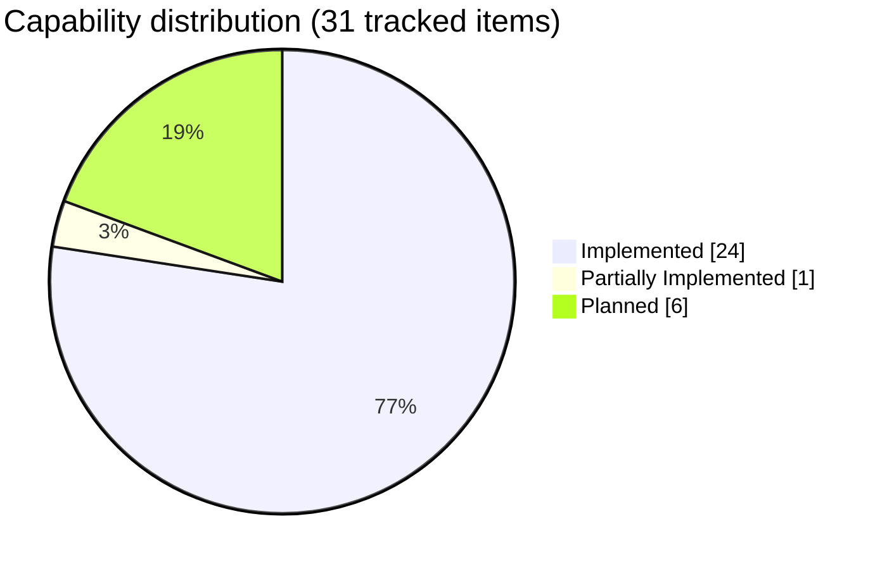
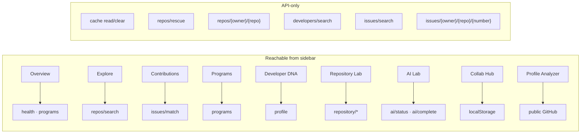

# Feature Status

**Last verified:** 2026-11-27 · **Verification basis:** 19 passing pytest tests, successful adapter import, valid `vercel.json`, static module checks, and source inspection. A live Vercel deployment has **not** been executed.

---

## 1. Status language

| Status | Definition |
| --- | --- |
| **Implemented** | Code exists and behavior was verified by tests, local execution or deterministic source checks |
| **Partially Implemented** | Working code exists, but a credential, provider or external verification step is missing |
| **Experimental** | Works for limited inputs and may change |
| **Planned** | Design is documented; no working implementation exists |

---

## 2. Capability matrix

### Core platform

| Feature | Status | Evidence / limitation |
| --- | --- | --- |
| Preserved analyzer: scores, charts, heatmap, theme | Implemented | `index.html`, `script.js`, `style.css`; nine preserved views intact |
| FastAPI backend, OpenAPI and health | Implemented | `backend/app/main.py`; docs moved to `/api/docs` to avoid static `docs/` collision |
| GitHub proxy with token and rate-limit mapping | Implemented | `services/github.py`; 403/429 → 429 test |
| Cache inspection and clear | Implemented (API-only) | `GET/DELETE /api/cache`; no sidebar view |
| Vercel adapter and routing | Implemented (config) | `api/index.py`, `vercel.json`, root `requirements.txt`, `.python-version`; live deploy pending |
| UI category alignment | Implemented | 16 UI options now match `CATEGORY_TOPICS` in `routers/explore.py` |

### Intelligence and discovery

| Feature | Status | Evidence / limitation |
| --- | --- | --- |
| Developer DNA: five scores, skill map, timeline | Implemented | `/api/profile/{username}`; deterministic heuristics |
| Original 100-point score parity | Implemented | `compute_legacy_score` mirrors the legacy formula; unit tested |
| Open Source Explorer | Implemented | `/api/repos/search`; real GitHub filters and pagination |
| Developer discovery | Implemented (API-only) | `/api/developers/search`; no `location` parameter |
| Project Rescue signals | Implemented (API-only) | `/api/repos/rescue`; no abandonment claim |
| Contribution Matcher | Implemented | `/api/issues/match`; candidates re-fetched without cache |
| Issue Intelligence | Implemented (API-only) | Search and detail routes; complexity analysis |
| Program registry | Implemented | Eight source-linked records; `lastVerified: 2026-11-26` |

### Repository tooling

| Feature | Status | Evidence / limitation |
| --- | --- | --- |
| README Doctor | Implemented | Score, findings, before/after draft, disabled write action |
| Repository Health | Implemented | Static checks; no vulnerability database query |
| Codebase X-Ray | Implemented | Bounded sample; evidence lines; no code execution |
| PR Guardian | Implemented | Confirmed findings separated from hypotheses |
| Documentation generators | Implemented | Four Markdown drafts; architecture uses sampled context |
| AI-improved README wording | Planned | Deterministic draft exists; no AI call is wired into this endpoint |

### Experience and output

| Feature | Status | Evidence / limitation |
| --- | --- | --- |
| Dashboard shell and nine views | Implemented | Hash routing, mount-once controllers, responsive shell |
| Collab Hub | Implemented | `localStorage` key `devatlas.collab.entries`, cap 100 |
| Reports and exports | Implemented | JSON, CSV and Markdown serializations |
| AI Lab endpoint and status UI | Partially Implemented | Provider path untested without `OPENAI_API_KEY` |
| Documentation set | Implemented | Product, architecture, operations, security, testing and research docs |
| Automated test suite | Implemented | 19 tests passed in current workspace |
| PDF export | Planned | Browser print dialog is the intentional substitute |

### Deferred platform work

| Feature | Status | Reason |
| --- | --- | --- |
| PostgreSQL persistence and migrations | Planned | No user accounts or server-side saved state in release 1 |
| Redis / shared cache | Planned | Process-local TTL cache is sufficient for public data |
| GitHub OAuth and write actions | Planned | Requires explicit authorization, scopes and audit trail |
| Background job queue | Planned | Synchronous bounded analysis avoids queue infrastructure |
| Real-time notifications | Planned | No event infrastructure or user identity in release 1 |
| Shared collaboration listings | Planned | Collab Hub is explicitly browser-local |

---

## 3. UI surface vs API surface

---

## 4. Verification evidence

| Check | Command | Result |
| --- | --- | --- |
| Backend tests | `cd backend && python -m pytest -q` | `19 passed` |
| Adapter import | `python -c "import api.index; print(api.index.app.title)"` | imported FastAPI app |
| Vercel config | `python -m json.tool vercel.json` | valid JSON |
| Frontend syntax | `node --check --input-type=module < assets/js/app.js` | passed in prior verification |
| Static routes | local FastAPI requests | `/`, `/style.css`, `/script.js`, `/assets/**` returned 200 in prior verification |
| Headless DOM | prior Chromium run | overview Online, eight program cards, analyzer activation |
| Live Vercel deploy | not executed | pending user deployment |

Historical live checks on `2026-11-26` verified real GitHub responses for `/api/health`, `/api/programs`, `/api/profile/octocat` and `/api/repos/search`. They are records, not guarantees for future upstream state.

---

## 5. Known gaps and honest caveats

| Gap | Impact | Current behavior |
| --- | --- | --- |
| Process-local cache | Warm-state hit rates vary by instance | Correctness unaffected; cold starts begin empty |
| Program data is a snapshot | Dates can become stale | Every record links to a verification source and shows `lastVerified` |
| Heuristic scores | Not an engineering assessment | Score blocks are named, bounded and evidence-based |
| Legacy `innerHTML` paths | Residual XSS surface | Preserved intentionally; new views use safe DOM APIs |
| AI provider path untested | No verified provider response in this workspace | Disabled state and error mapping are implemented |
| Repository sampling | Large projects are not fully analyzed | File count and size limits are explicit in responses |
| Two in-body errors | HTTP 200 can contain `error` | Clients must check `data.error` after parsing |

---

## 6. Acceptance bar for future changes

1. Add or update tests for changed behavior.
2. Run `python -m pytest -q` from `backend/`.
3. Syntax-check changed ES modules with `node --check --input-type=module`.
4. Update this status file and the API reference in the same commit.
5. Re-run the deployment smoke checklist in [`../operations/DEPLOYMENT.md`](../operations/DEPLOYMENT.md) if routing or config changes.
6. Never mark a feature Implemented only because a function exists — verify behavior first.
