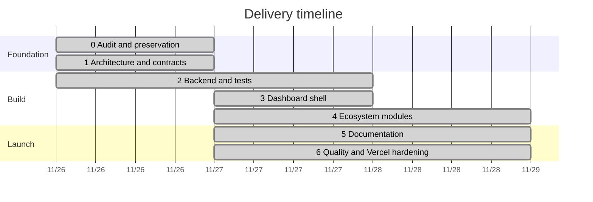
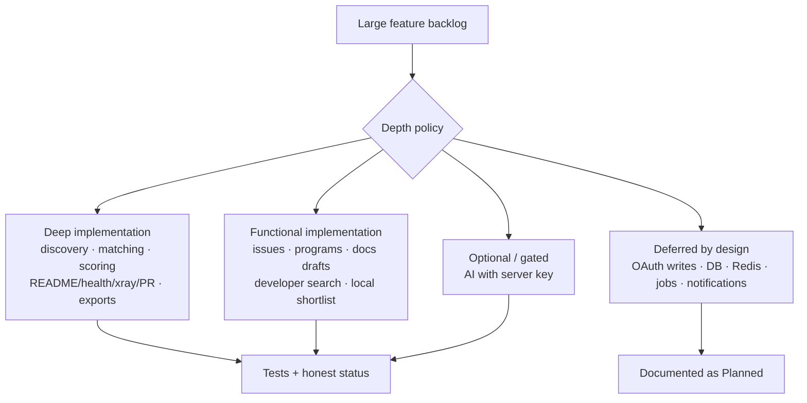
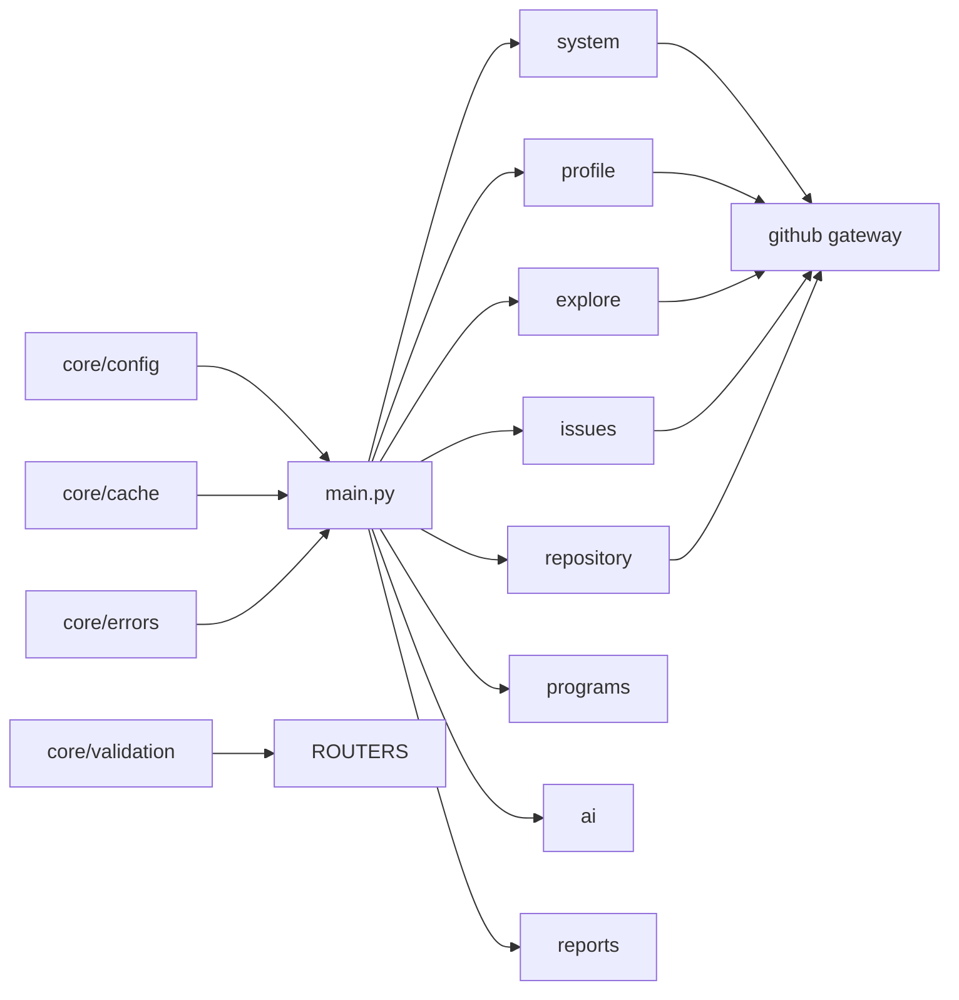
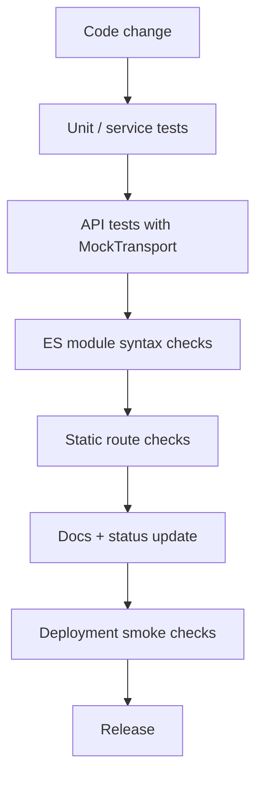
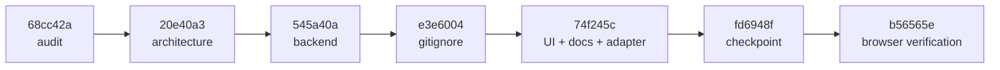

# Implementation Plan

**Status:** delivered release 1 · **History:** phased transformation from a static analyzer to a serverless-compatible workspace · **Current verification:** 2026-11-27

This plan replaced "build everything at once" with testable milestones. Each phase produced an artifact and a git checkpoint. The current branch is `main`; the original historical development began on `feat/developer-ecosystem`.

---

## 1. Phase timeline

| Phase | Scope | Exit criteria | Status |
| --- | --- | --- | --- |
| 0 — Audit | Read all source, inventory features, preservation checklist | [`PROJECT_AUDIT.md`](PROJECT_AUDIT.md) | Complete |
| 1 — Architecture | Modules, API contracts, security model, honest status file | [`../architecture/SYSTEM_OVERVIEW.md`](../architecture/SYSTEM_OVERVIEW.md), [`FEATURE_STATUS.md`](FEATURE_STATUS.md) | Complete |
| 2 — Backend | FastAPI, GitHub client, TTL cache, validators, deterministic services, tests | 19 tests; `/api/health`; OpenAPI | Complete |
| 3 — Dashboard shell | Sidebar, topbar, hash router, CSS system, preserved analyzer | Nine views mount; legacy analyzer still works | Complete |
| 4 — Ecosystem modules | Explore, contributions, programs, DNA, lab, AI, collab, exports | Real requests and honest empty/error states | Complete |
| 5 — Documentation | Full docs tree, root README, API reference | Docs match code and deployment config | Complete |
| 6 — Quality and launch | Tests, syntax checks, static route checks, Vercel hardening | Suite passes; adapter imports; config parses | Complete |

---

## 2. Scope policy

The first release prioritizes a coherent vertical slice: every sidebar item performs a real, bounded action, while capabilities that need identity, persistence or credentials are explicitly deferred rather than faked.

---

## 3. What was built

### Backend

- One GitHub gateway handles authentication, headers, timeouts, caching and rate-limit mapping.
- Eleven analyzers transform public data into deterministic findings.
- Eight routers expose 20 functional endpoints plus docs/static routes.
- Global handlers normalize `AppError`, validation errors and unexpected failures.

### Frontend

- Preserved legacy analyzer stays in `index.html`, `style.css` and `script.js`.
- Additive workspace uses `assets/css/app.css`, `api.js`, `ui.js`, `app.js` and eight view controllers.
- Hash router mounts each controller once and keeps the analyzer's chart sizing correct after visibility changes.
- New views render with DOM APIs; links are allowlisted.

### Operations

- Root `requirements.txt` and `.python-version` make Python dependency detection deterministic on Vercel.
- `api/index.py` is a recognized ASGI entrypoint that also pins `APP_ROOT`.
- `vercel.json` uses modern rewrites and headers, routes `/api/*` to the function, serves static files from CDN, and moves API docs under `/api/docs`.
- `docs/operations/DEPLOYMENT.md` contains the deploy, verify and troubleshooting runbook.

---

## 4. Verification gates

| Gate | Command / artifact | Current result |
| --- | --- | --- |
| Tests | `cd backend && python -m pytest -q` | 19 passed |
| Adapter import | `python -c "import api.index; ..."` | passed |
| Config parse | `python -m json.tool vercel.json` | passed |
| Frontend syntax | `node --check --input-type=module` | passed in prior verification |
| Static routes | local FastAPI requests | 200 in prior verification |
| Browser DOM | headless Chromium | overview/programs/analyzer verified in prior run |
| Live Vercel | deployment smoke checklist | pending user action |

---

## 5. Deliberate deferrals

| Item | Deferred because | Release-1 substitute |
| --- | --- | --- |
| GitHub write actions and OAuth | Needs explicit authorization, scopes, audit trail | Read-only tools; `writeAction.enabled: false` |
| PostgreSQL and migrations | No accounts or server-side saved state needed | GitHub as source of truth; no stored profile data |
| Redis | Shared cache unnecessary for public data | Bounded process-local TTLCache |
| Background jobs | Synchronous analysis is bounded and predictable | File/TTL/request limits |
| Real-time notifications | No identity or event infrastructure | Not implemented |
| PDF generation | Fake generators would be misleading | Browser print dialog |
| AI-based README rewriting | Provider path not verified in this workspace | Deterministic before/after draft |

---

## 6. Checkpoints

No history was rewritten or force-pushed. The Vercel hardening and documentation refresh in this session are intentionally left as uncommitted working-tree changes for you to review and push manually.

---

## 7. Definition of done for future work

1. Behavior is implemented, not just scaffolded.
2. Tests cover changed logic and pass from `backend/`.
3. Frontend modules pass syntax checks.
4. API reference and user guide reflect the change.
5. Feature status classification is updated with evidence.
6. Deployment config is rechecked if routing, env vars or dependencies change.
7. No secret is committed and no known limitation is presented as a finished feature.
