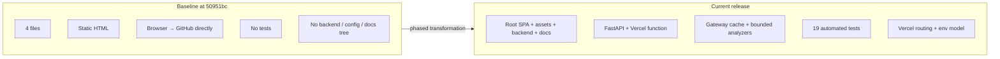
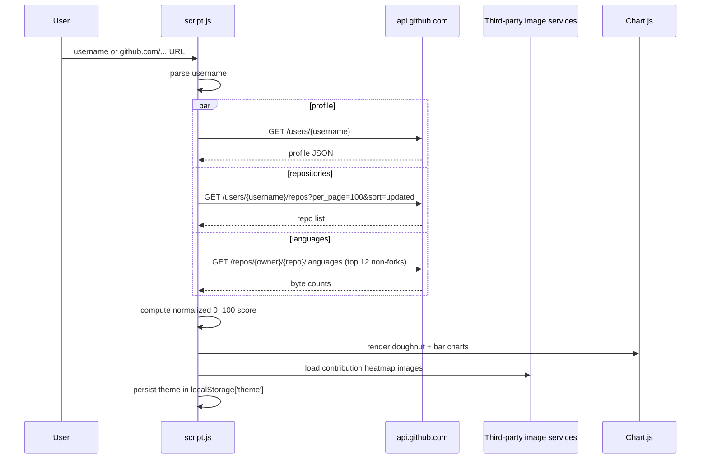
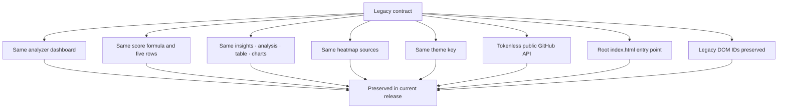
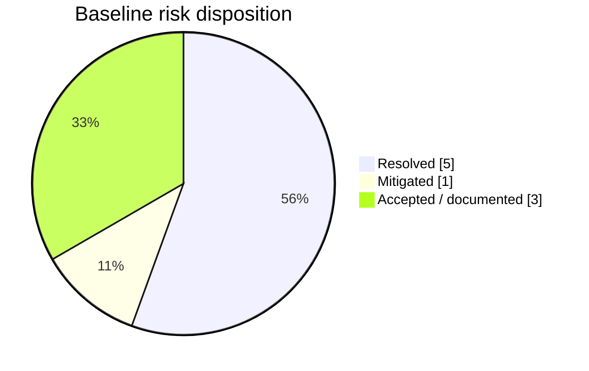
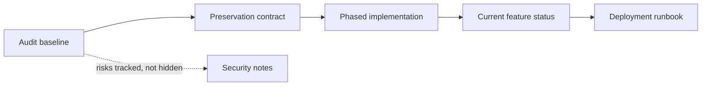

# Project Audit — Pre-Transformation Baseline

**Audit date:** 2026-11-26 · **Audited commit:** `main` at `50951bc` · **Historical development branch:** `feat/developer-ecosystem` · **Auditor:** automated repository inspection

> This is a historical record of the original static analyzer before the platform transformation. It is retained for traceability. Current capability is described in [`FEATURE_STATUS.md`](FEATURE_STATUS.md); current architecture in [`../architecture/SYSTEM_OVERVIEW.md`](../architecture/SYSTEM_OVERVIEW.md).

---

## 1. Then vs now

---

## 2. Baseline repository inventory

| Path | Size at audit | Role |
| --- | --- | --- |
| `index.html` | 270 lines | Static document: header, search form, dashboard markup |
| `script.js` | 713 lines | All logic: parsing, GitHub calls, scoring, charts, theme |
| `style.css` | 645 lines / 24 KB | Styling, CSS variables, themes, responsive rules |
| `README.md` | 164 lines | Overview and usage; partly outdated |

At that commit there was no build system, package manifest, backend, test suite, database, CI configuration, `vercel.json` or environment template. The site worked because any static host could serve `index.html`.

---

## 3. Baseline data flow

---

## 4. Working features at baseline

| Feature | Implementation | Status |
| --- | --- | --- |
| Username / URL parsing | `script.js:94-111` | Working |
| Profile overview | `script.js:307-328` | Working |
| Repository statistics | `script.js:499-521` | Working |
| Language distribution with fallback | `script.js:135-161`, `530-581` | Working |
| Normalized 100-point score | `script.js:202-242` | Working |
| Insight strip | `script.js:245-304`, `340-345` | Working |
| Eight deep-analysis observations | `script.js:377-471` | Working |
| Top 15 repository table | `script.js:473-496` | Working |
| Popularity bar chart | `script.js:583-633` | Working |
| Contribution heatmap with two sources | `script.js:643-707` | Working |
| Dark/light theme persistence | `script.js:65-91`, `style.css:4-43` | Working |
| Loading, empty and error states | `index.html:57-69`, `script.js:709-713` | Working |
| Responsive layouts | `style.css:629-645` | Working |

---

## 5. Preservation checklist

The original `#search-form`, `#github-input`, `#analyze-btn` and `#dashboard` IDs still exist inside `#view-analyzer`, so `script.js` continues to operate without modification.

---

## 6. Risk register and resolution

| ID | Severity at audit | Finding | Current disposition |
| --- | --- | --- | --- |
| A-01 | Medium | README documented an obsolete score formula | Resolved — current docs describe the normalized score |
| A-02 | Medium | 60/hour unauthenticated GitHub limit | Mitigated — backend token support, TTL cache and mapped 429 |
| A-03 | Medium | No server-side cache | Resolved — bounded `TTLCache`, 180/300/900s TTLs |
| A-04 | Medium | `innerHTML` interpolation without explicit escaping | Accepted and documented — legacy behavior preserved; new views use safe DOM APIs |
| A-05 | Low | `avgStars` divided by original repos only | Preserved — legacy semantics intentionally unchanged |
| A-06 | Low | Language fetch failures silently swallowed | Preserved — fallback behavior retained in legacy script |
| A-07 | Low | Third-party heatmap services receive username | Documented in [`../security/SECURITY.md`](../security/SECURITY.md) |
| A-08 | Low | No automated tests | Resolved — 19 tests in `backend/tests/` |
| A-09 | Low | No `vercel.json` | Resolved — modern Vercel config with rewrites, headers and Python function |

---

## 7. Baseline dependencies

| Dependency | Source | Current note |
| --- | --- | --- |
| Chart.js 4.x | jsDelivr CDN | Still used by the preserved analyzer |
| Inter + Space Grotesk | Google Fonts | Still loaded in `index.html` |
| GitHub REST | Unauthenticated in browser | Still used by legacy analyzer; backend gateway added |
| Contribution images | `ghchart.rshah.org`, `streak-stats.demolab.com` | Still used with fallback link |
| AI provider / auth / database | None at audit | AI proxy now optional; no auth or database by design |

---

## 8. Baseline verification

- Python 3.14.6, Node 24.18.0, npm 11.16.0 available at audit time.
- `fastapi`, `uvicorn`, `pytest`, `httpx` were already installed in that environment.
- Live check: `GET https://api.github.com/users/octocat` returned HTTP 200.
- No baseline test suite existed; the current suite was added in Phase 2.

---

## 9. Recovery state at audit time

The following statements were true **at the audited commit** and are retained only for historical accuracy:

- `main` remained untouched at `50951bc`.
- Transformation work was planned on `feat/developer-ecosystem`.
- A checkpoint commit was created after each completed phase.

Current checkout is on `main` with commits through `b56565e`; the transformation history is already merged into the visible log.

---

## 10. Why this document matters

The audit establishes what was intentionally preserved. It should not be used as current documentation: line numbers, file counts, branch state and "no backend/tests/deployment config" statements are historical.
