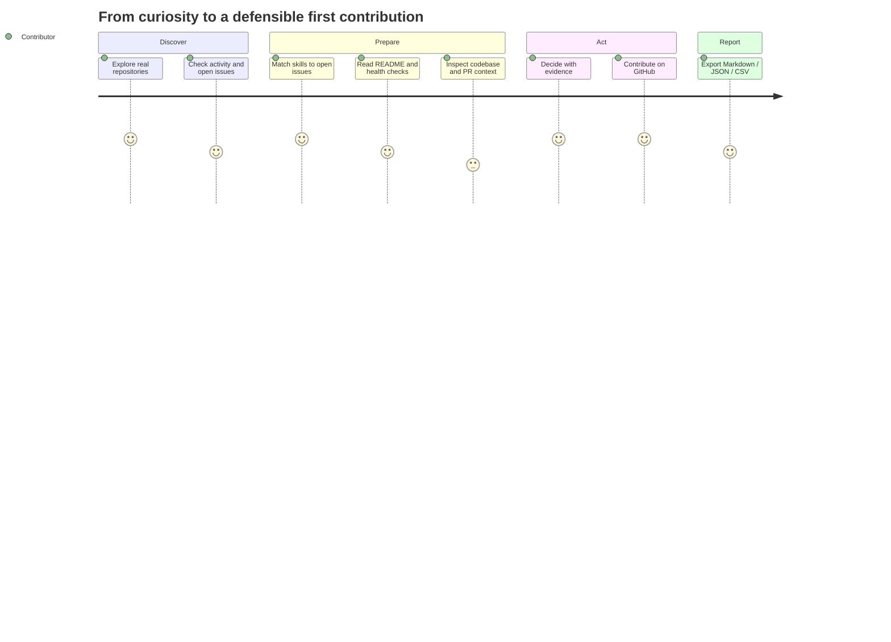
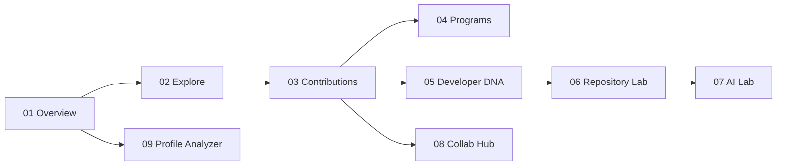
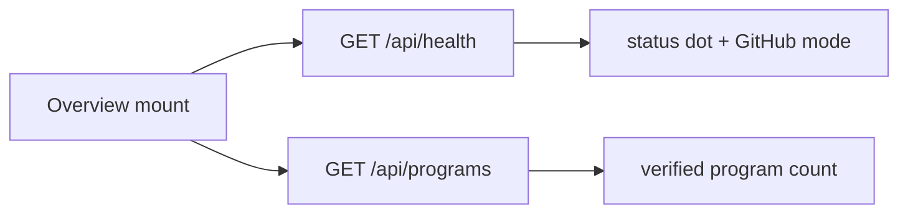
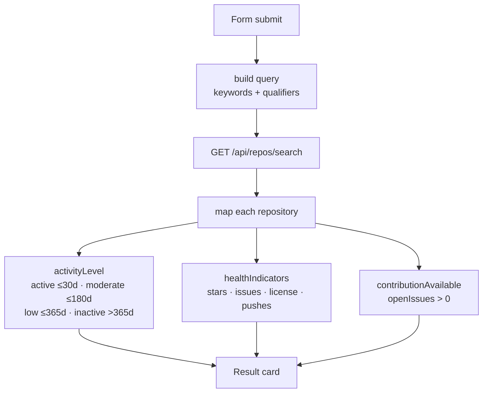
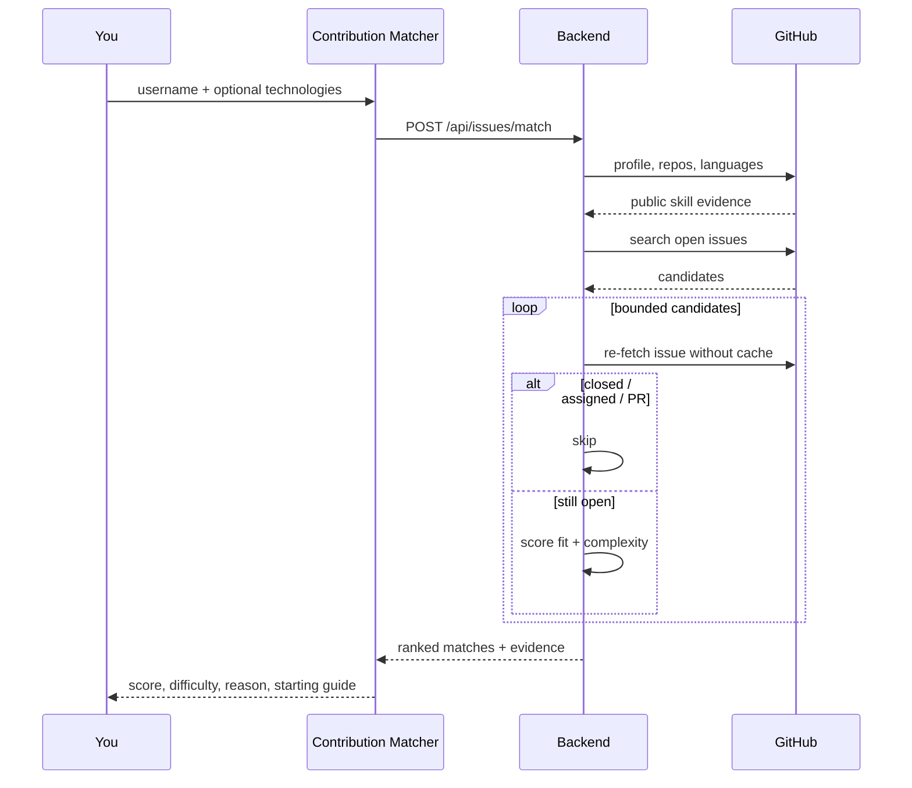
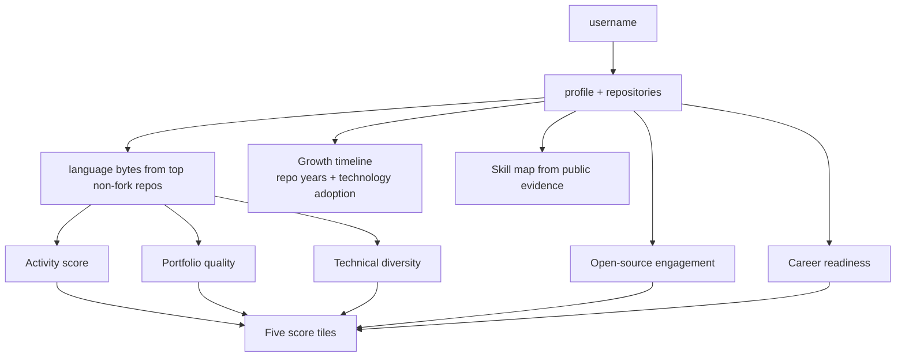
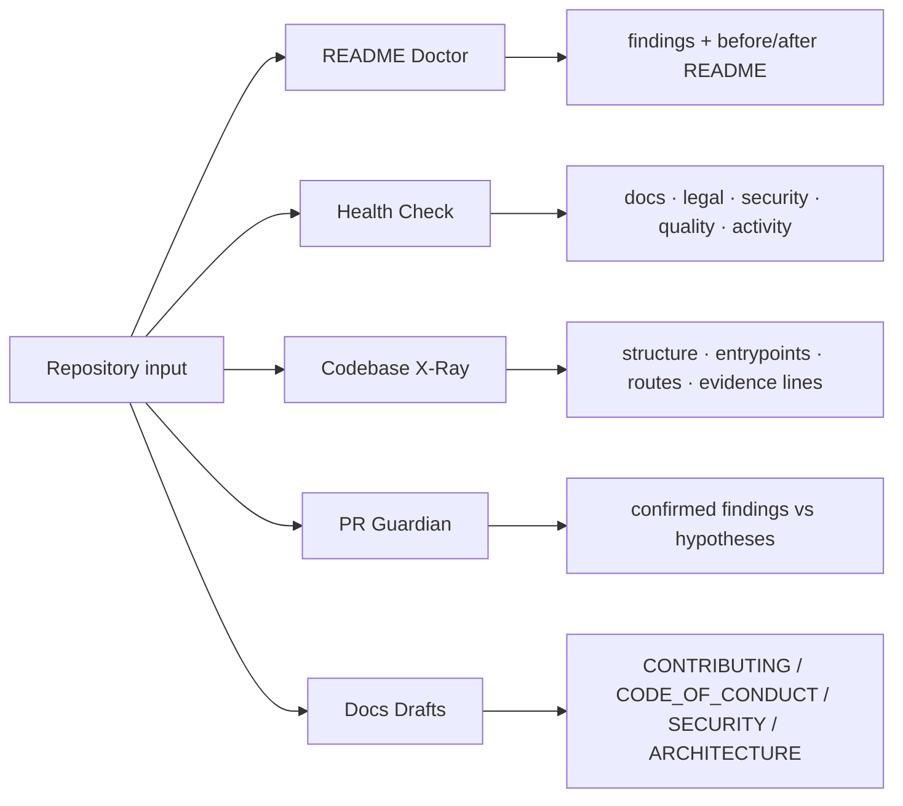
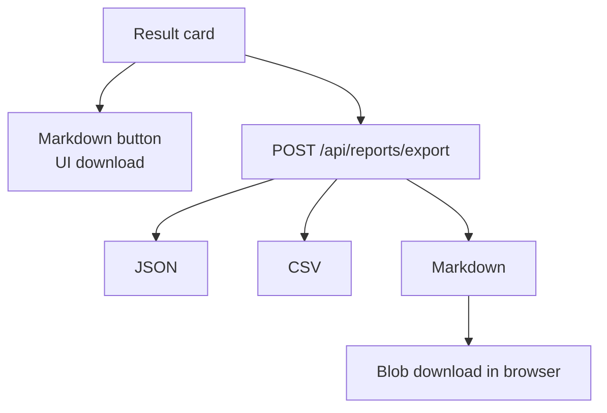

# User Guide

**Audience:** contributors, maintainers and open-source program applicants. Every screen shows live or source-linked data; nothing is seeded as a fake result.

---

## 1. The contributor journey





---

## 2. Start the application

### Deployed

Open the Vercel URL. No setup is required. The sidebar status dot turns green when `/api/health` responds.

### Local

```bash
python -m pip install -r requirements.txt
python -m pip install -r backend/requirements.txt
uvicorn app.main:app --app-dir backend --reload
```

Open <http://127.0.0.1:8000>. If the backend is stopped, workspace views show an offline message; the preserved analyzer can still call public GitHub directly.

---

## 3. View reference

### 01 — Overview

| Element | Meaning |
| --- | --- |
| Verified programs | Count from the current program registry |
| API status | `Online` when `/api/health` succeeds |
| Release | Platform version marker |
| Capability cards | Shortcuts to Explore, Contributions, Programs, Developer DNA, Repository Lab and Collab Hub |



---

### 02 — Explore

Enter keywords and optional filters. The backend builds a GitHub query with `archived:false`.

| Field | Behavior |
| --- | --- |
| Keywords | Free text, truncated to 200 characters |
| Language | GitHub `language:` qualifier |
| Category | One of 16 backend categories, mapped to GitHub topics |
| Minimum stars | `stars:>=N` from 0 to 1,000,000 |
| Sort | `stars`, `updated` or `forks`; invalid values fall back to `stars` |
| Results | 12 repositories per search by default |



Opening a result in Repository Lab carries `owner/repo` forward. Activity labels are metadata signals, not abandonment claims.

---

### 03 — Contributions



| Input | Limit |
| --- | --- |
| Username | 1–100 characters |
| Extra technologies | Free text appended to the skill query |
| Maximum matches | UI 1–20; API accepts 1–25 |

Match results include candidate count, revalidated count, skipped count, top skill evidence, fit score, difficulty, and a suggested first step. **Nothing is reserved for you.** Maintainers may close or assign an issue at any time; re-check before starting work.

---

### 04 — Programs

Filter by text, status, beginner friendliness and mentorship. Search is debounced by 250 ms.

| Status | Meaning |
| --- | --- |
| `upcoming` | Announced future cycle |
| `applications_open` | Accepting applications at verification time |
| `applications_closed` | Window closed |
| `ongoing` | Program in progress |
| `completed` | Cycle concluded |
| `status_unverified` | Official current-cycle dates could not be verified |

Unpublished deadlines display as **not published**. Each card links to the official site and verification source. See [`../research/PROGRAM_SOURCES.md`](../research/PROGRAM_SOURCES.md) for all eight records.

---

### 05 — Developer DNA

Enter a GitHub username to build an evidence-based profile.



The skill map uses public evidence only. Absence of evidence is not treated as lack of skill. Scores are transparent heuristics, not an assessment of engineering ability.

---

### 06 — Repository Lab

Enter `owner/repo` or a GitHub URL, then select a tool.



| Tool | What it checks | What it does not do |
| --- | --- | --- |
| README Doctor | Headings, installation, usage, screenshots, fences, links, badges, stale terms | Does not write to GitHub |
| Health Check | README, contributing guide, license, security policy, tests, CI, manifests, maintenance signals | Does not query a vulnerability database |
| Codebase X-Ray | Bounded file sample, extensions, directories, entrypoints, imports, routes, keywords | Does not execute code or generate a full architecture claim |
| PR Guardian | Missing tests, docs changes, possible breaking edits, TODO/FIXME, diff size, issue references, duplicate PR titles | Does not approve or merge anything |
| Docs Drafts | Four Markdown templates using repository context | Does not open pull requests |

Large repositories are sampled under explicit limits: 12 files for health, 24 for X-Ray, 20 for architecture drafts. Findings are evidence, not verdicts.

---

### 07 — AI Lab

The status panel reports whether the backend has `OPENAI_API_KEY`. Without it, requests return `503 ai_not_configured` and the UI shows setup guidance. No key reaches the browser.

AI output is labelled for critical review. Use it to draft wording or questions, not as a source of repository facts.

---

### 08 — Collab Hub

| Behavior | Detail |
| --- | --- |
| Storage key | `devatlas.collab.entries` |
| Capacity | 100 entries |
| Sync | None — current browser only |
| Seeding | None |
| URL validation | `http:` or `https:` only |
| Remove | Deletes one entry immediately |

Use this as a personal shortlist. It is not a shared marketplace or applicant directory.

---

### 09 — Profile Analyzer

The original analyzer is preserved. Enter a username or profile URL to see:

- profile overview and repository statistics;
- language distribution and the original 100-point normalized score;
- insight strip and eight deep-analysis observations;
- top repository table, two Chart.js charts and contribution heatmap;
- dark/light theme persisted under `theme`.

The legacy analyzer calls public GitHub directly and third-party image services for heatmaps. It does not use the FastAPI cache.

---

## 4. Exports



- Markdown buttons appear on supported result cards; not every card has one.
- JSON and CSV are API formats; call `/api/reports/export` or use `/api/docs`.
- For PDF, use your browser's print dialog. There is no fake PDF generator.

---

## 5. Understanding freshness

| Data | Freshness |
| --- | --- |
| Most GitHub GETs | Cached up to 900 seconds per function instance |
| Repository/user search | Cached up to 300 seconds |
| Issue search | Cached up to 180 seconds |
| Issue revalidation in matching | Fresh request, deliberately uncached |
| Programs | Verified snapshot dated `2026-11-26` |
| Collab Hub | Whatever your browser has stored |

If a result looks stale, wait for TTL expiry or call `DELETE /api/cache` if you have API access.

---

## 6. Troubleshooting

| Symptom | Meaning | Action |
| --- | --- | --- |
| Sidebar says **Offline** | `/api/health` unreachable | Check deployment logs or start local backend |
| `GitHub public mode` | No `GITHUB_TOKEN` | Set the backend secret to raise the 60/hour limit |
| HTTP 429 | GitHub rate limit exhausted | Wait for reset or configure a token |
| AI Lab says not configured | No backend key | Set `OPENAI_API_KEY`, or ignore AI features |
| Program deadline says not published | Source did not publish a date | Check the official site; do not guess |
| Charts have zero width | Legacy view was hidden during creation | Navigate away and back; resize is scheduled automatically |
| Empty Explore result | Filters too narrow or category mismatch | Remove filters; use one of the 16 supported categories |
| Repository Lab says invalid repository | Non-GitHub host or unsafe path | Use `owner/repo` or a GitHub URL |
