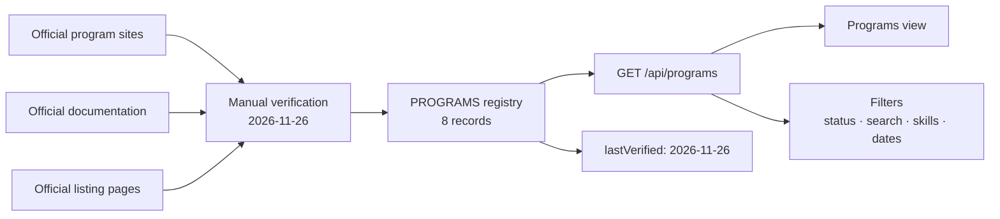
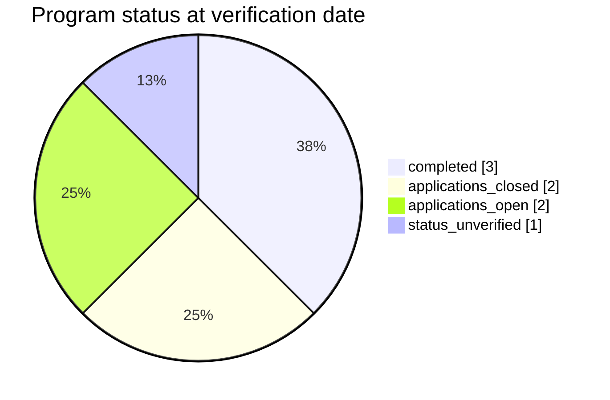
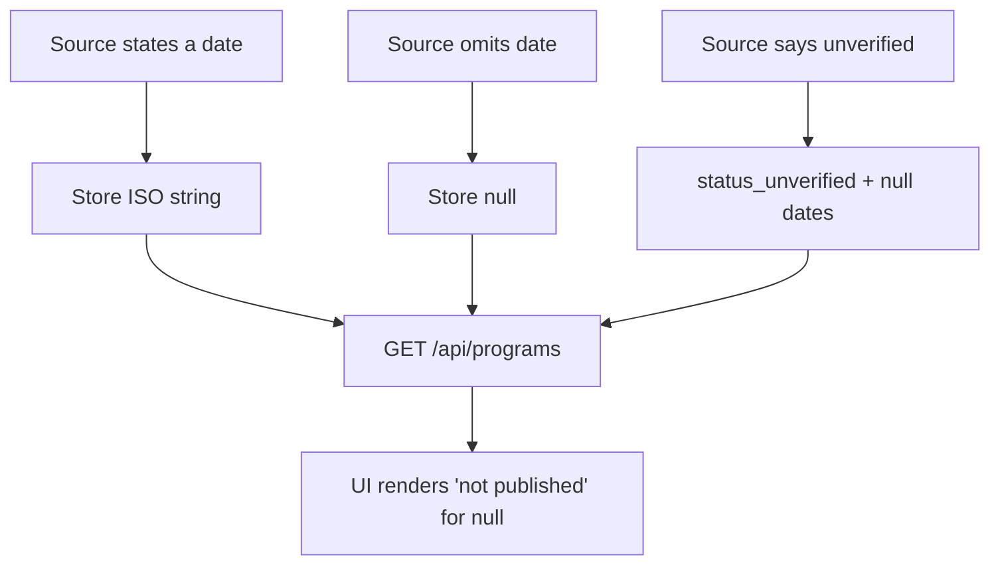
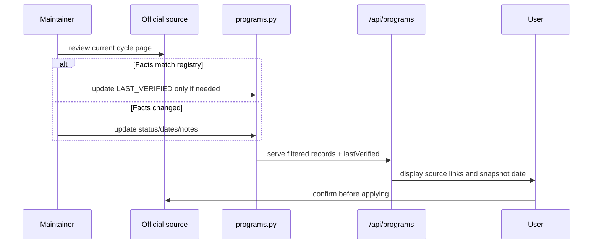
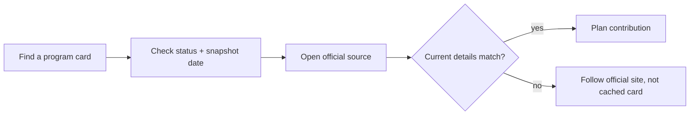

# Program Sources

**Snapshot verified:** 2026-11-26 · **Registry source of truth:** [`backend/app/services/programs.py`](../../backend/app/services/programs.py) · **API:** `GET /api/programs`

This document explains where the eight program records came from, what was verifiable at the snapshot date, and why missing dates remain `null`. It is research provenance, not a promise that an application window is still open.

---

## 1. Provenance flow

The registry is curated data. The backend does **not** scrape these sites at request time. This keeps responses deterministic, avoids fragile selectors, and makes every displayed claim traceable to a source link.

---

## 2. Status snapshot

| Status | Count | Interpretation |
| --- | --- | --- |
| `applications_open` | 2 | Official site accepted applications at verification time |
| `applications_closed` | 2 | A specific cycle deadline had passed |
| `completed` | 3 | The verified 2026 cycle had concluded |
| `status_unverified` | 1 | Current-cycle information could not be confirmed |
| `upcoming` | 0 | No unpublished future cycle was invented |
| `ongoing` | 0 | No record was asserted as ongoing without verified dates |

---

## 3. Verified records

### 3.1 Google Summer of Code 2026

| Field | Value |
| --- | --- |
| ID | `gsoc-2026` |
| Organization | Google |
| Status | `completed` |
| Official | [summerofcode.withgoogle.com](https://summerofcode.withgoogle.com/) |
| Verification source | [Official GSoC timeline](https://developers.google.com/open-source/gsoc/timeline) |
| Application window | Opens `2026-03-16`; closes `2026-03-31T18:00:00Z` |
| Duration | 8–22 weeks; program rules window ended `2026-11-11` |
| Mentorship / beginner | Yes / Yes |
| Skills | Git, collaboration, project-specific language |
| Note | 2026 timeline verified from official Google developer documentation. Next-cycle dates are not published in this registry. |

### 3.2 GirlScript Summer of Code

| Field | Value |
| --- | --- |
| ID | `gssoc` |
| Organization | GirlScript Foundation |
| Status | `status_unverified` |
| Official / apply | [gssoc.girlscript.tech](https://gssoc.girlscript.tech/) |
| Verification source | [Official program site](https://gssoc.girlscript.tech/) |
| Application dates | `null` / `null` |
| Duration | Historically three months; confirm on official site |
| Mentorship / beginner | Yes / Yes |
| Skills | Git, GitHub, basic programming |
| Note | Official site still showed 2025 content. A 2026 edition is referenced by GirlScript, but dates were not verified, so none are shown. |

### 3.3 Outreachy December 2026 cohort

| Field | Value |
| --- | --- |
| ID | `outreachy-dec-2026` |
| Organization | Outreachy |
| Status | `applications_closed` |
| Official | [outreachy.org](https://www.outreachy.org/) |
| Apply | [outreachy.org/apply](https://www.outreachy.org/apply/) |
| Verification source | [Applicant documentation](https://www.outreachy.org/docs/applicant/) |
| Application window | Opens `2026-08-24T16:00:00Z`; final deadline `2026-11-09T16:00:00Z` |
| Duration | `2026-12-07` to `2027-03-08` |
| Mentorship / beginner | Yes / Yes |
| Skills | Git, communication, project-specific skills |
| Note | Final deadline passed. Accepted interns were scheduled to be announced `2026-11-30`. |

### 3.4 LFX Mentorship

| Field | Value |
| --- | --- |
| ID | `lfx-mentorship` |
| Organization | Linux Foundation |
| Status | `applications_open` |
| Official | [LFX Mentorship](https://mentorship.lfx.linuxfoundation.org/) |
| Apply | [Program listings](https://mentorship.lfx.linuxfoundation.org/programs) |
| Verification source | [LFX Mentorship](https://mentorship.lfx.linuxfoundation.org/) |
| Application dates | `null` / `null` — per-program terms |
| Duration | Per-program terms, commonly around 12 weeks |
| Mentorship / beginner | Yes / Yes |
| Skills | Git, project-specific technologies |
| Note | Official site reported programs accepting applications at verification time. Each program page lists its own deadline. |

### 3.5 Women in Energy Open Source Mentorship (WIEOS)

| Field | Value |
| --- | --- |
| ID | `wieos-2026` |
| Organization | Open Energy Transition / LF Energy |
| Status | `applications_open` |
| Official / apply | [Official LFX program page](https://mentorship.lfx.linuxfoundation.org/programs/633c2c60-1be0-4aa5-913e-afa7e3fe26fd) |
| Verification source | [Official LFX program page](https://mentorship.lfx.linuxfoundation.org/programs/633c2c60-1be0-4aa5-913e-afa7e3fe26fd) |
| Application deadline | `2026-12-12` |
| Open date | `null` — not published in the verified page data |
| Duration | 16–20 weeks |
| Mentorship / beginner | Yes / Yes |
| Skills | Python, Git, GitHub, optional GIS/SQL |
| Note | Application close date shown on the official LFX program page at verification time. |

### 3.6 Season of KDE 2026

| Field | Value |
| --- | --- |
| ID | `season-of-kde-2026` |
| Organization | KDE |
| Status | `completed` |
| Official / apply | [season.kde.org](https://season.kde.org/) |
| Verification source | [season.kde.org](https://season.kde.org/) |
| Application window | Opens `2025-12-15`; closes `2026-01-14` |
| Duration | `2026-01-23` to `2026-03-20` |
| Mentorship / beginner | Yes / Yes |
| Skills | Qt/C++ or KDE-specific skills, communication |
| Note | 2026 dates verified on the official site. A 2027 season was not verified. |

### 3.7 MLH Fellowship

| Field | Value |
| --- | --- |
| ID | `mlh-fellowship` |
| Organization | Major League Hacking |
| Status | `applications_closed` |
| Official | [fellowship.mlh.io](https://fellowship.mlh.io/) |
| Apply | [fellowship.mlh.io/apply](https://fellowship.mlh.io/apply) |
| Verification source | [Official application page](https://fellowship.mlh.io/apply) |
| Application deadline | `2026-04-30` |
| Open date | `null` — not published in the verified page data |
| Duration | 12 weeks; batches run multiple times per year |
| Mentorship / beginner | Yes / Yes |
| Skills | One programming language, collaboration |
| Note | Summer 2026 deadline verified from the official application page. Later batch dates were not verified. |

### 3.8 Hacktoberfest 2026

| Field | Value |
| --- | --- |
| ID | `hacktoberfest-2026` |
| Organization | MLH and DEV |
| Status | `completed` |
| Official | [hacktoberfest.com](https://hacktoberfest.com/) |
| Apply / participant area | [hacktoberfest.com/my](https://hacktoberfest.com/my/) |
| Verification source | [hacktoberfest.com](https://hacktoberfest.com/) |
| Application dates | `null` / `null` — event, not application cycle |
| Duration | October 2026; concluded `2026-10-31` |
| Mentorship / beginner | No / Yes |
| Skills | Git, GitHub |
| Note | 2026 event concluded on `2026-10-31`. Pull requests no longer count toward rewards in 2026. |

---

## 4. Eligibility and skill snapshot

| Program | Eligibility summary | Required skills | Tags |
| --- | --- | --- | --- |
| GSoC 2026 | 18+, non-embargoed country, limited prior open-source experience; official rules apply | Git, collaboration, project language | mentorship, paid, student, global |
| GSSoC | Check official site for current eligibility | Git, GitHub, basic programming | beginner, students, mentorship |
| Outreachy Dec 2026 | 18+ by `2026-12-07`, 30 h/week, not a past Outreachy/GSoC intern; regional/student rules apply | Git, communication, project skills | paid, remote, diversity, internship |
| LFX Mentorship | 18+, consistent weekly commitment, up to three applications, one LFX mentorship per career | Git, project technologies | paid, cloud, linux, rolling |
| WIEOS | Different starting points including non-coders, data analysts and experienced developers | Python, Git, GitHub, optional GIS/SQL | python, energy, beginner, mentorship, women |
| Season of KDE 2026 | Worldwide; selection favours early community engagement | Qt/C++ or KDE skills, communication | kde, desktop, mentorship |
| MLH Fellowship | 18+, non-embargoed residence, 20 h/week, English proficiency, one prior MLH event | One programming language, collaboration | remote, fallback, web3, devops |
| Hacktoberfest 2026 | 13+, subject to country rules; events may add rules | Git, GitHub | october, events, beginner |

Eligibility is summarized for discovery only. Applicants must read the linked official rules before investing time.

---

## 5. Date handling

Rules:

1. `applicationOpenDate` and `applicationDeadline` are nullable. `null` means **not published / not verified**, never “closed”.
2. `upcomingDays` filtering uses the first 10 characters of `applicationDeadline`; records with `null` deadlines are skipped for that filter.
3. `search` examines name, organization, description, tags and skills.
4. `technology` examines skills and tags.
5. Invalid `status` filters return an in-body error; clients must check `data.error` even on HTTP 200.

---

## 6. Verification lifecycle

Maintenance steps:

1. Re-open every `verificationSource` link.
2. Update `status`, dates, duration and notes only from official text.
3. Set `LAST_VERIFIED` to the review date.
4. Add or update a test if shape or filtering changes.
5. Update this document in the same commit.
6. Never infer a deadline from a previous year.

---

## 7. Integrity checks

| Check | Where enforced | Expected |
| --- | --- | --- |
| Eight records | `test_programs_are_verified_shape` via API | `total > 0`; current snapshot has exactly 8 |
| HTTPS official URLs | Same test | Every `officialUrl` starts with `https://` |
| Deadline type | Same test | `null` or ISO string |
| Verification date | Same test | Every item has `lastVerified: 2026-11-26` |
| Unknown status | `list_programs` | Raises `ValueError`; router maps to in-body `invalid_status` |
| UI truthfulness | Programs view | Unpublished deadlines show “not published”; no defaults invented |

---

## 8. How to use this responsibly

The registry is a discovery aid. Dates, eligibility and rewards change without notice. Treat every card as a lead and every linked official page as the final authority.
