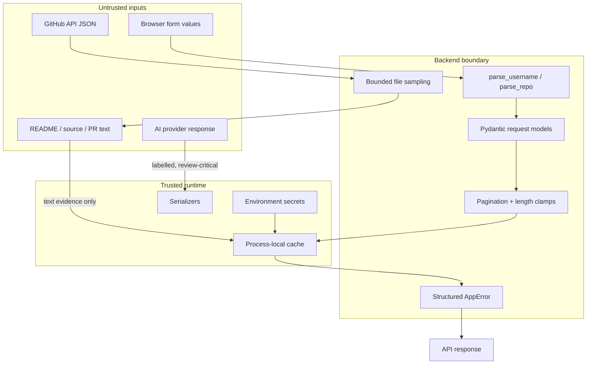
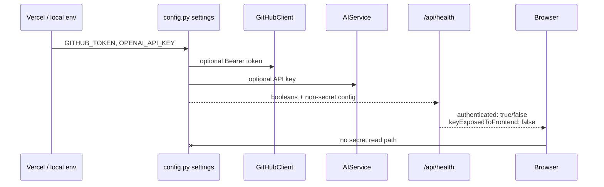
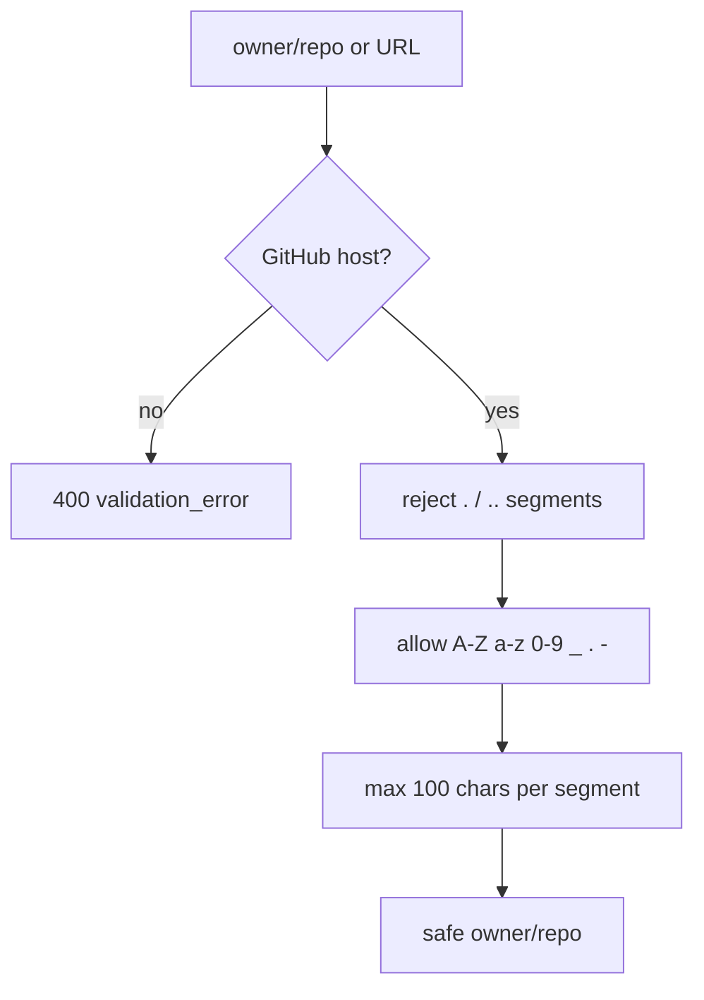
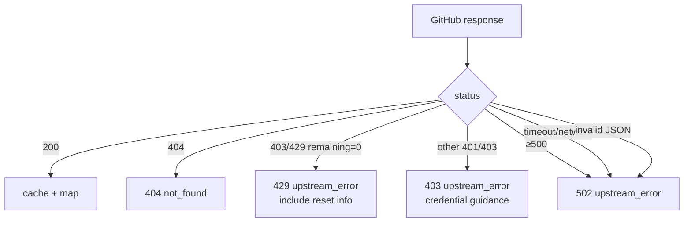
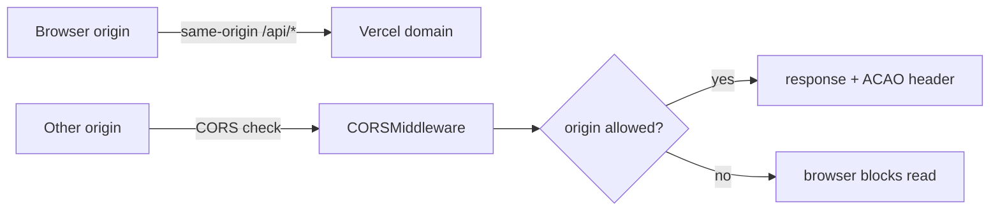
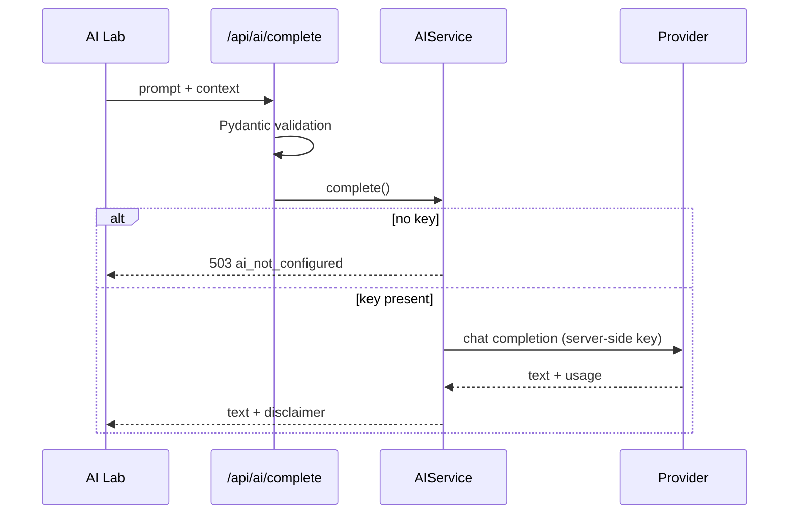
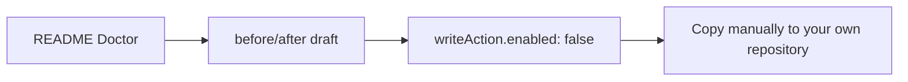

# Security Notes

**Scope:** implemented controls, residual risks and explicit non-features. Security claims are deliberately narrow: this project performs public-data analysis and has no write path.

---

## 1. Trust boundaries

Repository content is **data**. It is fetched as text, sampled under hard limits, and never executed or passed to a shell.

---

## 2. Secret handling

| Secret | Read by | Sent to | Returned to browser |
| --- | --- | --- | --- |
| `GITHUB_TOKEN` | `backend/app/core/config.py` | `api.github.com` as Bearer | No — only `authenticated` flag |
| `OPENAI_API_KEY` | `backend/app/core/config.py` | configured provider as Bearer | No — only `enabled`/`model` flags |
| Browser storage | `script.js`, `views/collab.js` | same browser only | Theme and shortlist only |

Operational rules:

- Set secrets in Vercel Project Settings or a local `.env`, never in `index.html`, `assets/` or Git.
- `.env`, `backend/.env`, `.venv/` and bytecode are ignored by Git.
- `CORS_ORIGINS` is not a secret; it is an allowlist of browser origins.
- `GITHUB_API_BASE` and `OPENAI_BASE_URL` must point to trusted hosts. Redirecting `GITHUB_API_BASE` would also redirect the Bearer token.

---

## 3. Input validation matrix

| Input | Validation | Failure |
| --- | --- | --- |
| Username | Strips URL/prefix/whitespace; 1–39 chars, alphanumeric edges, optional internal hyphens | `400 validation_error` |
| Repository | Bare `owner/repo` or GitHub/www.github.com URL; strips `.git`; rejects `.`/`..` segments and non-`[A-Za-z0-9_.-]` chars | `400 validation_error` |
| Host allowlist | Only GitHub hosts accepted by `parse_repo` | Blocks SSRF-style host substitution |
| Pagination | Page 1–1000; `perPage` 1–100, sometimes lower | `422 invalid_request` |
| Search text | Truncated to 200 chars for repo/issue search, 150 for developer search | Silent clamp |
| Labels | Quoted, capped at five in the generated GitHub query | Silent clamp |
| File path | No leading slash, no `..` segment | `400 validation_error` |
| File size | ≤200,000 bytes per blob; count limits 12 / 20 / 24 by tool | Oversized files skipped |
| PR number | Integer ≥1 | `400 validation_error` |
| AI prompt/context | Prompt 1–8000, context ≤16,000, tokens 64–800 | `400` or `503` |
| Export format | `json`, `csv`, `markdown` only | `422 invalid_request` |

---

## 4. Output encoding

| Surface | Mechanism | Status |
| --- | --- | --- |
| Workspace views | `document.createElement` + `textContent` | Values are not concatenated into `innerHTML` |
| Workspace links | `safeUrl()` allowlist, `rel="noopener noreferrer"` | Only `http:`/`https:` |
| Markdown output | Rendered as text/drafts, not raw injected HTML | No backend HTML sanitizer exists |
| Legacy analyzer | `innerHTML` in table, analysis grid and heatmap fallback | Preserved behavior; residual XSS surface if GitHub metadata were ever hostile |

The legacy caveat is explicit: GitHub normalizes most fields, but the code does not perform defensive escaping. It is documented rather than claimed as mitigated because the analyzer is intentionally preserved.

---

## 5. Upstream errors and rate limits

- Cache keys include path and sorted query parameters, so repeated identical reads avoid upstream calls.
- Search caches are short-lived (300s / 180s), reducing stale triage data.
- Error payloads never include headers, tokens or request secrets.
- `GET /api/health` exposes GitHub API base, integration flags, timestamp and cache stats — no token values.

---

## 6. CORS and browser boundary

- Credentials are **not** allowed (`allow_credentials=False`).
- Methods: `GET`, `POST`, `DELETE`, `OPTIONS`. Headers: `Content-Type`, `Accept`.
- Default allowed origins: `http://localhost:8000`, `http://127.0.0.1:8000`, plus `https://$VERCEL_URL` when Vercel provides it.
- If `CORS_ORIGINS` is explicitly set, it replaces the defaults. Add your exact custom domain scheme and host if cross-origin clients need access.
- Same-origin dashboard requests do not require an allowlist entry.

---

## 7. AI boundary

- No key means no AI call; deterministic tools remain available.
- Provider output is labelled for critical review and is never treated as a fact source.
- The prompt asks for evidence and avoids invented repository facts, but prompt content supplied by a caller could contain sensitive text. Do not paste secrets into AI Lab.
- Provider failures map to distinct codes: `ai_provider_unavailable`, `ai_provider_rejected`, `ai_rate_limited`, `ai_provider_error`, `ai_response_invalid`.

---

## 8. Write actions

No API endpoint writes to GitHub or any external system.

OAuth, scoped tokens, explicit confirmation and audit events are future requirements documented in [`../architecture/DATABASE_SCHEMA.md`](../architecture/DATABASE_SCHEMA.md). They are not enabled by deployment.

---

## 9. External dependencies

| Dependency | Loaded by | Data sent | Mitigation |
| --- | --- | --- | --- |
| Chart.js (jsDelivr) | `index.html` | CDN request metadata | Pin or self-host if supply-chain policy requires |
| Google Fonts | `index.html` | CDN request metadata | Optional visual dependency |
| `api.github.com` | Legacy `script.js` | analyzed username | Public GitHub REST, no token |
| `ghchart.rshah.org` | Legacy heatmap | analyzed username | Third-party image service; privacy note needed for strict policies |
| `streak-stats.demolab.com` | Legacy heatmap fallback | analyzed username | Same caveat |
| OpenAI-compatible API | Backend only | prompt + context | Server-side key; no browser exposure |

Static CDN dependencies bypass FastAPI middleware. The workspace's `/assets/*` files are first-party and cached with explicit headers.

---

## 10. Threat model

| Threat | Control | Residual risk |
| --- | --- | --- |
| Token leaked to browser | Env-only config; boolean status endpoints | Developer could paste a token into a form; not preventable by app code |
| SSRF via repository URL | GitHub-only host validation, traversal rejection | Redirects or DNS rebinding are not separately guarded beyond `httpx` defaults |
| Malicious repository content | Treated as text; bounded files; no execution | Very large trees are truncated; findings are heuristics |
| XSS via API data | DOM APIs in new views; link allowlist | Legacy `innerHTML` paths remain |
| Rate-limit exhaustion | Optional token, TTL cache, mapped 429 | Unauthenticated shared IP can still hit GitHub limits |
| Prompt injection through repo text | AI output labelled non-authoritative | LLM cannot be made trustworthy by prompt text alone |
| Cross-origin misuse | CORS allowlist, no credentials | CORS is not authentication; public API remains public |
| Data retention creep | No database; short-lived cache; local shortlist | Browser users own their local storage lifecycle |

---

## 11. Known non-features

- No secret scanning is performed; health reports say `secretScanning: "not_performed"`.
- No vulnerability database query; only manifest versions are parsed.
- No code from analyzed repositories is executed.
- No authentication, authorization, audit log or database exists.
- No GitHub write action or OAuth flow exists.

---

## 12. Pre-deployment checklist

- [ ] Secrets set only in Vercel Environment Variables.
- [ ] `GITHUB_API_BASE` left on `https://api.github.com`.
- [ ] `OPENAI_API_KEY` omitted unless AI Lab is intentionally enabled.
- [ ] `CORS_ORIGINS` either unset or contains exact required origins.
- [ ] `/api/health` returns no secret value.
- [ ] `/api/docs` loads and does not expose credentials.
- [ ] Frontend bundle searched for token names and key material.
- [ ] Program registry dates reviewed against official sources before relying on them.
