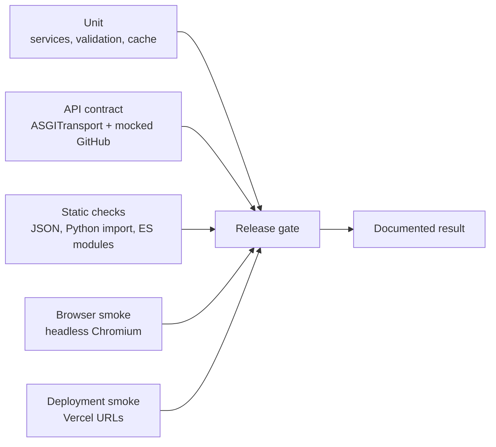
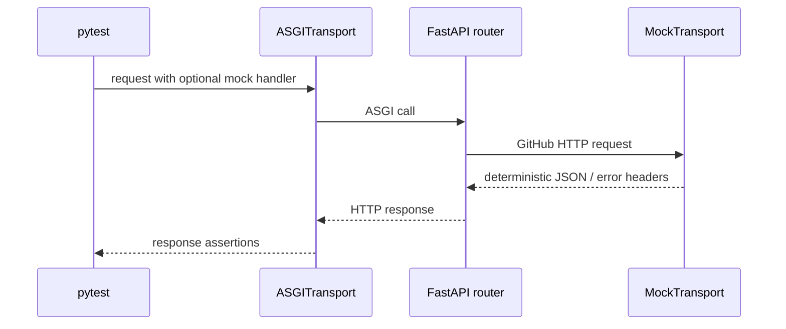
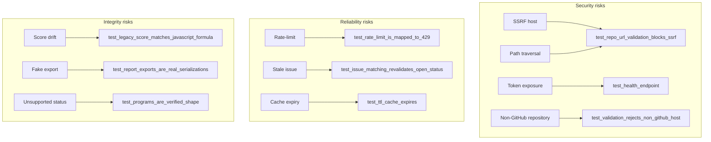
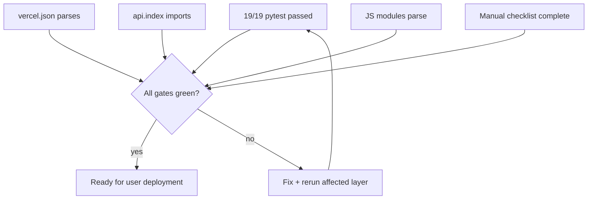

# Test Plan

**Suite:** 19 automated tests in `backend/tests/` · **Last run:** 2026-11-27 · **Result:** `19 passed` · **Deployment:** config-verified, live Vercel deployment pending

This plan covers deterministic backend behavior, browser/static checks already performed, and the remaining manual smoke tests. Tests deliberately use `httpx.MockTransport` and `ASGITransport`; the suite never requires GitHub credentials or network access.

---

## 1. Test strategy



| Layer | Goal | Network | Status |
| --- | --- | --- | --- |
| Unit | Verify pure transformations and guards | None | 10 passed |
| API contract | Verify routes, response shape and error mapping | Mocked | 9 passed |
| Static | Verify config, imports and module syntax | None | Passed locally |
| Browser | Verify view mounting and preserved analyzer IDs | Local | Passed in prior run |
| Deployment | Verify live Vercel routes | Live | Pending user deploy |

---

## 2. Commands

```bash
# Backend suite
cd backend
python -m pytest -q

# Vercel configuration
cd ..
python -m json.tool vercel.json
python -c "import api.index; print(api.index.app.title)"

# Frontend modules
Get-ChildItem -Recurse assets\js -Filter *.js | ForEach-Object {
  node --check --input-type=module < $_.FullName
}
```

The PowerShell ES-module loop is the Windows equivalent of checking all 11 modules; individual modules can also be checked with `node --check --input-type=module < assets/js/app.js`.

---

## 3. Automated backend inventory

### API contract tests — `test_api.py`

| Test | Verifies |
| --- | --- |
| `test_health_endpoint` | HTTP 200, `status: ok`, GitHub/AI integration groups, token exposure flag |
| `test_profile_endpoint_uses_real_api_shape` | Profile/statistics/scores mapping, star total, legacy breakdown, skill evidence, language-data note |
| `test_explorer_filters_and_maps_real_data` | Query construction for language/category/stars, `active` level, contribution availability |
| `test_issue_matching_revalidates_open_status` | Stale search results re-fetched; closed issue skipped; `skippedCount` and `revalidatedCount` |
| `test_readme_doctor_returns_before_and_after` | README score, suggested `## Usage`, original text, disabled write action |
| `test_programs_are_verified_shape` | HTTPS official URLs, nullable/string deadlines, `lastVerified: 2026-11-26` |
| `test_ai_is_disabled_without_key` | `/api/ai/status` disabled and completion returns `503 ai_not_configured` |
| `test_validation_rejects_non_github_host` | Non-GitHub URL rejected with `400 validation_error` |
| `test_rate_limit_is_mapped_to_429` | GitHub 403 with `x-ratelimit-remaining: 0` becomes status 429 |



### Service and unit tests — `test_services.py`

| Test | Verifies |
| --- | --- |
| `test_repo_url_validation_blocks_ssrf` | GitHub URL/`owner/repo.git` parsing; rejects foreign hosts, traversal and invalid usernames |
| `test_ttl_cache_expires` | Lazy expiry, value hit, then miss counter |
| `test_legacy_score_matches_javascript_formula` | Stars/repos/followers/languages/age breakdown matches the original script |
| `test_readme_analyzer_detects_missing_sections_and_empty_heading` | Missing installation, empty section, no screenshots findings |
| `test_readme_analyzer_detects_unclosed_code_fence` | Unclosed fence finding |
| `test_issue_complexity_uses_labels_and_evidence` | Beginner vs advanced difficulty from labels/body/comments/age |
| `test_codebase_ask_returns_evidence_with_lines` | File path, line number and confidence in X-Ray evidence |
| `test_pr_guard_distinguishes_confirmed_and_hypotheses` | Confirmed findings, hypotheses and change-impact confidence |
| `test_docs_generator_uses_repository_context` | Contributing/security drafts use repo name; unknown kind raises |
| `test_report_exports_are_real_serializations` | JSON/CSV/Markdown content; PDF rejected |

### Fixtures — `conftest.py`

| Fixture | Purpose |
| --- | --- |
| `cache` | Fresh `TTLCache(60, 100)` per test |
| `github_client` | `GitHubClient` backed by an empty mock transport |
| `api_client` | Full app with mocked GitHub/AI state for static routes and disabled states |
| `make_client(handler)` | Factory for custom GitHub response handlers |
| `json_response(data, status_code, headers)` | Deterministic `httpx.Response` builder |

---

## 4. Risk coverage matrix



| Risk | Covered | Residual |
| --- | --- | --- |
| SSRF / unsafe repository input | Yes, unit + API | No other repository input path |
| Token leakage to browser | Yes, health flag | Static source inspection also required |
| GitHub rate limit | Yes, 403/429 mapping | Live reset headers vary by GitHub |
| Stale issue suggestions | Yes, revalidation test | Maintainers can still change state after response |
| Cache correctness | Yes, expiry test | Cold-start hit rate on Vercel is not deterministic |
| README analysis quality | Yes, finding tests | Heuristic findings, not human review |
| Export formats | Yes, real serializations | PDF intentionally unsupported |
| AI provider behavior | Disabled state only | No key configured |

---

## 5. Static and historical browser checks

Already executed in this workspace:

- HTML tag balance checked with Python `html.parser`; no unclosed or mismatched tags.
- All 11 ES modules checked with `node --check --input-type=module`.
- FastAPI served `/`, `/style.css`, `/script.js`, `/assets/css/app.css`, `/assets/js/app.js` and `/assets/js/views/repository.js` with HTTP 200.
- Live backend verified real GitHub data for `/api/health`, `/api/programs`, `/api/profile/octocat` and `/api/repos/search`.
- Headless Chromium verified that `app.js` executes: overview shows `Online`, sidebar reports GitHub public mode, `#programs` renders eight program cards, and `#analyzer` activates the preserved analyzer with original IDs.
- A headless screenshot was generated; visual inspection was unavailable because image input was not supported.

These records are evidence, not a promise that upstream GitHub data or live deployment state is unchanged.

---

## 6. Manual verification checklist

### Navigation

- [ ] Visit every hash route: `#overview`, `#explore`, `#contributions`, `#programs`, `#dna`, `#lab`, `#ai`, `#collab`, `#analyzer`.
- [ ] Confirm sidebar active state and topbar label update for each route.
- [ ] Return to `#analyzer` twice and confirm charts still have nonzero width.

### Preserved analyzer

- [ ] Analyze a username and a GitHub profile URL.
- [ ] Confirm overview, insights, analysis, repository table, charts and heatmap render.
- [ ] Toggle theme, reload, and confirm `localStorage['theme']` persists.
- [ ] Trigger an unknown user and confirm the error state appears.

### Workspace views

- [ ] Search repositories with and without category/language/star filters.
- [ ] Match contributions for a known username; verify candidate count, skipped count and disclaimer.
- [ ] Filter programs by open status, beginner friendly and mentorship.
- [ ] Run README Doctor on a public repository; confirm no write occurred.
- [ ] Run Health Check, X-Ray and PR Guardian; confirm evidence lines and bounded sampling notices.
- [ ] Confirm AI Lab shows setup guidance when no key is configured.
- [ ] Add, reload and remove a Collab Hub entry.
- [ ] Export Markdown from a supported card; verify downloaded filename and content.

### Offline behavior

- [ ] Stop the backend and confirm the API-offline message appears in workspace views.
- [ ] Confirm the preserved analyzer can still call GitHub directly.

### Deployment

- [ ] Visit `/api/health`, `/`, `/assets/js/app.js`, `/api/docs` and `/api/openapi.json`.
- [ ] Confirm static assets return long-lived cache headers and API routes return `no-store`.
- [ ] Confirm `/docs` serves the SPA, not Swagger UI.
- [ ] Confirm CORS allows the intended production origin only.

---

## 7. Not verified / intentionally excluded

| Item | Reason |
| --- | --- |
| Live Vercel deployment | No deployment was executed; user will deploy manually |
| AI provider response | No `OPENAI_API_KEY` configured in this workspace |
| Playwright/jsdom suite | Not installed; headless Chromium was used instead |
| Visual screenshot review | Image input unavailable to the reviewing model |
| GitHub write flows | Intentionally not implemented |
| OAuth / database / Redis | Deferred by design; no code path exists |
| PDF export | Intentionally unsupported; browser print dialog is the substitute |

---

## 8. Release gate



Do not mark the release as deploy-verified until the deployment checklist passes against the user's Vercel project.
